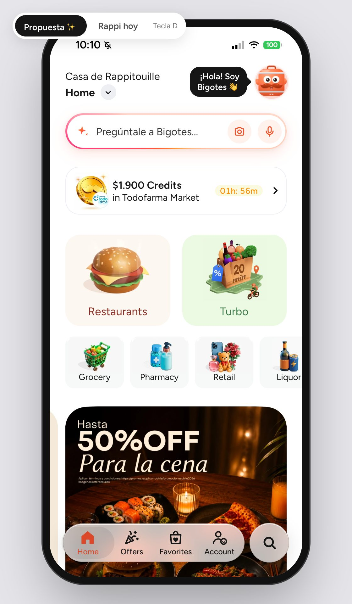
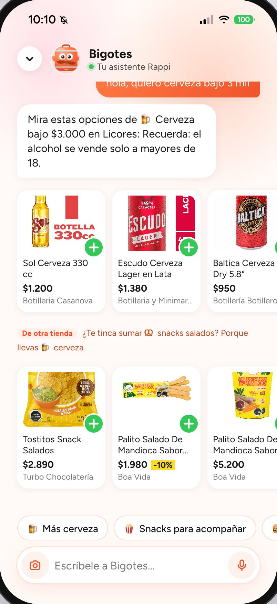
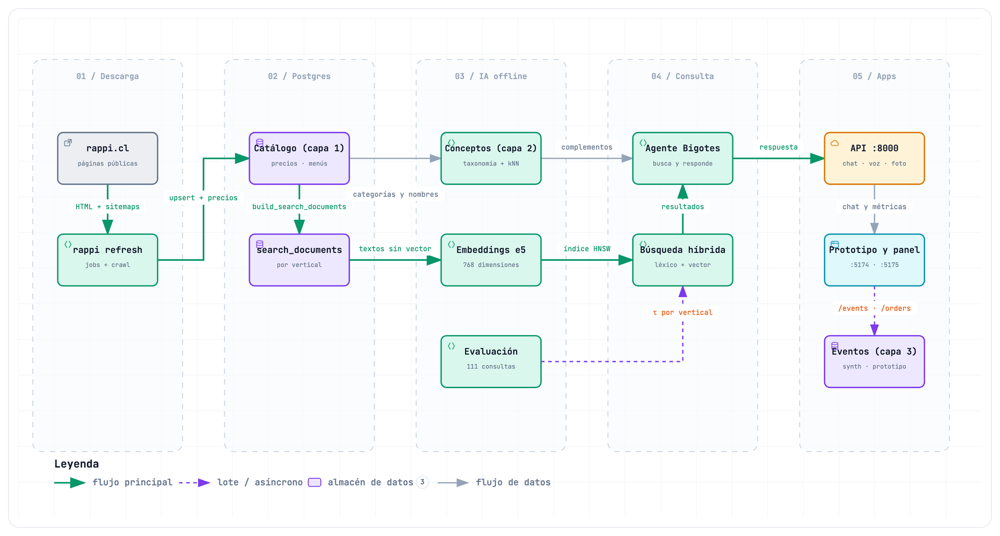

# rappi-dlab · Recomendaciones entre verticales para Rappi Chile

Prototipo que muestra cómo lo que una persona hace en un vertical de Rappi (supermercado, licores, farmacia, restaurantes…) puede mejorar lo que se le recomienda en los demás. Reúne el catálogo público de rappi.cl en Postgres + pgvector, una búsqueda híbrida evaluada, el asistente **Bigotes** y un panel de negocio.

> [!NOTE]
> Proyecto independiente: no está afiliado a Rappi ni cuenta con su respaldo. Rappi y las demás marcas mencionadas pertenecen a sus respectivos dueños.

[](https://github.com/yungzyx/rappi-dlab/actions/workflows/ci.yml)



*Prototipo navegable. El interruptor de arriba (tecla **D**) alterna entre la app como es hoy y la propuesta.*

## El problema

Vista desde fuera, como usuarios de la app, cada vertical de Rappi parece funcionar como un silo: lo que una persona compra o busca en el supermercado no parece cambiar lo que se le recomienda en licores, farmacia o restaurantes.

La señal existe: cada búsqueda y cada pedido dice algo de quien lo hace. Pero no se ve que cruce de un vertical a otro, y con ella se pueden perder oportunidades de venta cruzada y de frecuencia.

El proyecto no tiene acceso a datos internos: con ellos, Rappi puede confirmarlo o descartarlo. Detalle en [docs/contexto-y-problema.md](docs/contexto-y-problema.md).

## La propuesta

**Buscar dentro del vertical, entender a través de los verticales.**

- **La búsqueda sigue aislada por vertical.** Quien está en Licores ve resultados de Licores: así se cuida la precisión.
- **Los intereses se guardan como conceptos** comunes a todos los verticales (cerveza, snacks salados, pañales…).
- **Una recomendación cruzada sigue tres pasos:** concepto → complemento → búsqueda en el otro vertical.

| Lo que hace la persona | Concepto | Complemento | Dónde se busca | Qué ve |
|---|---|---|---|---|
| Pide cerveza bajo $3.000 en Licores | cerveza | snacks salados | otro vertical, donde el concepto es más típico (Turbo) | «De Turbo · ¿Te tinca sumar snacks salados? Porque llevas cerveza», con un botón «Ver más en Turbo» |
| Compra pañales en el supermercado | pañales | alimentación de bebé | el vertical donde ese concepto es más típico (farmacia), no el de más ítems | «De Farmacia · ¿Te tinca sumar alimentación de bebé? Porque llevas pañales» |

Ejemplos ilustrativos: el complemento y el vertical se eligen según el peso de la relación entre conceptos y el surtido real de cada vertical.



Las sugerencias siguen reglas pensadas para no perder la confianza del cliente:

- como máximo una sugerencia cruzada por respuesta, siempre con su razón visible;
- nunca productos sensibles por iniciativa propia (medicamentos, salud sexual, tabaco y vapeo);
- el alcohol siempre con el aviso +18;
- lo aprendido se muestra («Aprendiendo de ti») y se puede borrar («Olvidar»).

El panel de negocio muestra cómo se mediría el efecto (frecuencia, abandono, sugerencias aceptadas), pero con datos simulados. El efecto real solo se puede medir con datos de Rappi y un experimento A/B con grupo de control.

## Qué hay en el repositorio

| Carpeta | Qué es | Datos |
|---|---|---|
| [`rappi-scraper/`](rappi-scraper/) | Descarga el catálogo público de rappi.cl (tiendas, productos, menús y precios con historial) a Postgres + pgvector y arma los documentos de búsqueda por vertical. Se actualiza cada semana. | Reales (públicos) |
| [`rappi-ia/`](rappi-ia/) | Conceptos (capa 2), embeddings locales de texto e imagen, voz a texto con Whisper, búsqueda híbrida por vertical, agente Bigotes, eventos y métricas. API con FastAPI. | Catálogo real; usuarios simulados |
| [`prototipo-app/`](prototipo-app/) | Réplica navegable de la app (Vite + React) con modo «Rappi hoy» / «Propuesta». Funciona sin backend; con la API usa el catálogo real. | Capturas de la app; catálogo real opcional |
| [`dashboard-empresa/`](dashboard-empresa/) | Panel de negocio: demanda no satisfecha, tendencias, frecuencia, abandono, cruce entre verticales y salud del catálogo. | Simulados, salvo la pestaña Catálogo (real) |

**Bigotes** es el asistente del prototipo: la mochila de Rappi con bigote. Conversa por texto, voz o foto y busca en el vertical donde está la persona. Sugiere como máximo un complemento de otro vertical. Sin clave de API responde con plantillas; con clave, Claude solo redacta sobre lo que el código ya recuperó y verificó.

## Arquitectura



1. **Descarga (semanal).** `rappi refresh` lee las páginas públicas y guarda catálogo, menús y precios.
2. **Postgres + pgvector.** El catálogo (capa 1) y `search_documents`, una partición por vertical.
3. **IA offline.** Cada producto y plato recibe un concepto (capa 2), y los conceptos se enlazan con sus complementos. Cada documento recibe un embedding: un vector que representa el significado del texto, calculado con un modelo local multilingüe (e5). Cada vertical tiene su propio índice vectorial. Una evaluación calibra el umbral de «sin resultado».
4. **Consulta.** Búsqueda híbrida dentro del vertical: por palabras (léxica) y por significado (vectorial). Las dos listas se combinan según la posición de cada resultado (fusión RRF) y se refuerzan los resultados del concepto pedido. Bigotes arma la respuesta y la sugerencia cruzada.
5. **Apps.** La API (puerto 8000) atiende al prototipo (5174) y al panel (5175). Los eventos del prototipo vuelven a la base marcados como tales.

Versiones interactivas (GitHub no las muestra: descargar y abrir en el navegador): [flujo de datos](docs/diagramas/rag-datos.html) · [arquitectura por carriles](docs/diagramas/arquitectura-ia.html) ([PNG](docs/diagramas/arquitectura-ia.png)) · [scraper](docs/diagramas/scraper-flujo.html) ([PNG](docs/diagramas/scraper-flujo.png)).

Diseño completo del RAG, el agente y el panel: [docs/diseno-ia.md](docs/diseno-ia.md).

## Resultados

Cifras al 30-09-2026, tras la primera descarga semanal automática, salvo donde se indica otra fecha. Cada una indica qué tipo de dato es: real, evaluación automática, estimación o simulación.

| Ámbito | Métrica | Valor | Tipo de dato | Fuente |
|---|---|---|---|---|
| Catálogo | Documentos de búsqueda | 270.607: 93.823 productos, 172.278 platos y 4.506 tiendas | Real (catálogo público) | Base `rappi`, 30-09-2026 |
| Catálogo | Documentos con embedding | 100 % (`intfloat/multilingual-e5-base`, 768 dim, HNSW por vertical) | Real | Base `rappi`, 30-09-2026 |
| Catálogo | Grupos de tiendas (uno por marca y formato) | 753 descargados · 26 fallidos · 49 omitidos (marca ya descargada) | Real | Corrida 5 (tiendas), 29-09 |
| Catálogo | Restaurantes | 3.259 descargados · 301 fallidos · 1.295 omitidos | Real | Corrida 6 (restaurantes), 29 y 30-09 |
| Capa 2 | Taxonomía | 132 conceptos · 101 complementos curados · 757 categorías con mapeo revisado (131 nuevas sin mapear, con sugerencia en `rappi-ia map-categories`) | Taxonomía y complementos: curados a mano · mapa de categorías: generado con LLM (dos etiquetadores y un juez en los desacuerdos), versionado en `category_map.csv` | `make concepts`, 30-09-2026 |
| Capa 2 | Ítems con concepto | 97,1 % a 100 % según vertical ([tabla](#catálogo-por-vertical)) | Real | `make concepts`, 30-09-2026 |
| Capa 2 | Precisión de la asignación | ≈88 % por categoría · ≈81 % platos · 55 % reglas por nombre | **Estimación**: jueces LLM sobre datos parciales | Muestra del 27-09, no versionada |
| Búsqueda | nDCG@10 | híbrido 0,910 · sin refuerzo por concepto 0,860 · vectorial 0,846 · léxico 0,778 | Evaluación automática | [`docs/resultados/busqueda-2026-09-30.md`](docs/resultados/busqueda-2026-09-30.md) |
| Búsqueda | «Sin resultado» | precisión 1,00 (0 falsas alarmas) · recall 0,71 (29 de 41) | Evaluación automática | [`docs/resultados/busqueda-2026-09-30.md`](docs/resultados/busqueda-2026-09-30.md) |
| Calidad | Tests (pytest / Vitest) | scraper 104 · rappi-ia 189 · prototipo 117 · panel 80 | Verificación local, 30-09 | `make test` · `npm test`; [CI](.github/workflows/ci.yml): 4 jobs (scraper y rappi-ia contra Postgres + pgvector; prototipo y panel con lint, tests y build) y un job semanal que instala los modelos con las versiones fijadas |
| Calidad | Revisión adversarial automatizada (agentes de IA) | 3 pasadas, 66 hallazgos corregidos (27-09); auditoría del 28-09 con 4 bloques de mejoras (29 y 30-09) | Proceso | — |
| Panel | Usuarios, eventos y pedidos | 1.500 usuarios × 20 semanas (semilla 7) | **Simulado** | `rappi-ia/src/rappi_ia/events/synth.py` |

### Catálogo por vertical

Documentos de búsqueda al 30-09-2026, tras la primera descarga semanal automática (corridas 5 y 6).

| Vertical | Tiendas | Productos | Con concepto |
|---|---:|---:|---:|
| Supermercado | 367 | 32.730 | 99,1 % |
| Conveniencia | 59 | 9.240 | 99,8 % |
| Turbo | 16 | 2.562 | 100 % |
| Rappi Mall | 384 | 36.089 | 98,1 % |
| Farmacia | 20 | 6.323 | 97,1 % |
| Licores | 84 | 5.734 | 100 % |
| Chocolatería | 27 | 1.145 | 100 % |
| Restaurantes | 3.549 | 172.278 platos | 97,9 % |

- «Tiendas» cuenta las tiendas del vertical en la búsqueda; de cada marca y formato se descarga una sucursal. Una misma tienda puede figurar en más de un vertical.
- **Turbo quedó con los precios del 27-09:** en la descarga semanal, los listados públicos que recorre el scraper ya no traen sus tiendas como Turbo, así que no se descargaron (ver [Límites](#límites)).
- En tiendas es una muestra: la página pública muestra hasta 24 productos por sub-pasillo. Los restaurantes traen el menú completo.

### Búsqueda

124 consultas positivas en los 8 verticales y 41 negativas (al menos 5 por vertical). La relevancia se juzga automáticamente por concepto. Set: [`queries.json`](rappi-ia/src/rappi_ia/eval/queries.json), renovado el 29-09 con el catálogo completo: suma farmacia y Turbo, y cada negativa se verificó contra la base (ninguna calza todas sus palabras ni nombra un concepto con surtido en su vertical). Cifras con el catálogo del 30-09 (primera descarga semanal automática) y la búsqueda ya sin HTML en las descripciones.

| Modo | P@10 | MRR | nDCG@10 |
|---|---:|---:|---:|
| Léxico | 0,769 | 0,868 | 0,778 |
| Vectorial | 0,838 | 0,907 | 0,846 |
| **Híbrido** | **0,905** | **0,939** | **0,910** |
| Híbrido sin refuerzo por concepto | 0,856 | 0,913 | 0,860 |

El refuerzo por concepto reordena con la misma etiqueta con que se juzga la relevancia; la fila «sin refuerzo» es la medida justa de la fusión léxico + vectorial. Consulta por consulta, sin refuerzo el híbrido gana 30, empata 67 y pierde 27 contra el vectorial: diferencia media 0,014, con un intervalo de confianza del 95 % de −0,012 a 0,042 (no concluyente). La fusión sí ayuda sola en las consultas sin tildes (0,884 frente a 0,769). Reporte completo: [`docs/resultados/busqueda-2026-09-30.md`](docs/resultados/busqueda-2026-09-30.md).

P@10: proporción de resultados relevantes entre los 10 primeros. MRR: qué tan arriba aparece el primer resultado relevante (1 = el primero). nDCG@10: calidad del orden de los 10 primeros (1 = orden ideal).

- **Por tipo de consulta** (nDCG@10 del híbrido): exactas 0,979; sin tildes 0,965; necesidades en lenguaje natural («algo para el carrete») 0,711, frente a 0,570 del léxico.
- **Por vertical** (nDCG@10 del híbrido): farmacia 0,979; chocolatería 0,956; restaurantes 0,942; Turbo 0,915; Rappi Mall 0,907; conveniencia 0,903; supermercado 0,896; licores 0,847.
- **«Sin resultado»** (demanda no satisfecha), con los τ recalibrados el 29-09: detectó 29 de las 41 negativas (recall 0,71) sin falsas alarmas (precisión 1,00).
  - Con el catálogo del 28-09 eran 31: en la descarga del 30-09 conveniencia ya tiene televisores y un local de restaurantes vende pañales, así que dos negativas dejaron de serlo.
  - Las 12 no detectadas tienen tres causas, que el reporte explica una por una: 5 nombran un concepto que el vertical sí tiene (un iPhone en supermercado, que vende celulares), 4 calzan por casualidad con la regla léxica estricta («pizza familiar» → un horno para pizza en Rappi Mall) y 3 quedan sobre τ por coseno. Es un límite real de la regla.
  - τ por vertical: farmacia, Turbo, conveniencia y licores tienen τ calibrado; chocolatería y restaurantes no tienen negativas que dependan de τ y conservan el suyo; Rappi Mall conserva 0,70 y el reporte del 30-09 propone 0,82, pendiente de revisar.
- **Antes (28-09, set anterior sin farmacia ni Turbo):** híbrido 0,889; «sin resultado» con recall 0,33 (5 de 15). Tres de esas negativas estaban desactualizadas («kebab mixto» y «comida mexicana con tacos» sí existen en restaurantes).
- **Antes (27-09, datos parciales):** híbrido 0,898; «sin resultado» con precisión 0,91 y recall 0,67. No es comparable directamente: cambió el catálogo.

> [!IMPORTANT]
> **Qué no es evidencia**
>
> - **El panel de negocio.** Usuarios, eventos y pedidos son simulados (`source = 'synthetic'`). Muestran la mecánica, no un resultado. Por ejemplo, el simulador asume que quien usa más verticales se va menos, así que esa relación aparece por construcción. Solo la pestaña Catálogo usa datos reales.
> - **La ventaja del híbrido.** La relevancia se juzga por concepto y el híbrido recibe un refuerzo por ese mismo concepto. Sin el refuerzo, el híbrido no se distingue del vectorial (0,860 frente a 0,846): con este set no se puede saber si el refuerzo mejora de verdad. Falta un juicio humano.
> - **La precisión de la capa 2.** Es una estimación con jueces LLM sobre datos parciales, con una muestra no versionada.
> - **«No está en el catálogo».** No significa «Rappi no lo vende»: en tiendas el catálogo es una muestra.

## Verlo funcionando

### Sin base de datos (unos 2 minutos)

Requiere Node 22.22+ o 24.15+. Desde la raíz del repositorio, cada uno en su terminal:

```bash
cd prototipo-app && npm ci && npm run dev       # http://localhost:5174
```

```bash
cd dashboard-empresa && npm ci && npm run dev   # http://localhost:5175
```

- **Prototipo:** la tecla **D** (o Account → Settings → Modo demo en el celular) alterna «Rappi hoy» y «Propuesta». Sin la API, Bigotes responde con reglas locales sobre los datos de las capturas y lo marca con «Respuesta local».
- **Panel:** sin la API usa respuestas guardadas (`src/fixtures/`) y lo avisa («Modo sin conexión (datos guardados)»). Cada bloque indica si su dato es simulado o real.

### Correr la demo completa (catálogo real)

Requiere la base `rappi` con el catálogo (se restaura desde un respaldo) y la capa de IA instalada: ver [docs/instalacion.md](docs/instalacion.md). Luego, desde la raíz, cada uno en su terminal:

```bash
cd rappi-ia && make serve             # API en http://localhost:8000 (docs en /docs; carga los modelos antes de aceptar peticiones: esperar a «Application startup complete»)
cd prototipo-app && npm run dev       # http://localhost:5174
cd dashboard-empresa && npm run dev   # http://localhost:5175
```

Con la API, Bigotes busca en el catálogo real con precios vigentes, sugiere complementos de otro vertical, transcribe la voz (Whisper) y reconoce fotos (CLIP). La API no tiene autenticación y por defecto escucha solo en el equipo local. `make serve-lan` la abre a la red local para probar desde un iPhone: solo en una red de confianza.

### Actualización semanal

`make schedule` en `rappi-scraper/` programa la tarea (con launchd, el programador de tareas de macOS; domingos 03:00): primero la descarga y después `make post-refresh` de rappi-ia (purga, conceptos, embeddings, evaluación y datos simulados). Nunca corren dos descargas a la vez: todos los comandos que descargan comparten un candado. `make schedule-status` muestra cómo terminó cada semana. Si hay un `rappi refresh` lanzado a mano, `cd rappi-ia && ./scripts/despues-del-refresh.sh` espera a que termine y corre `make post-refresh` (este sí recalibra τ). Detalle en [docs/instalacion.md](docs/instalacion.md).

## Stack

| Capa | Tecnología |
|---|---|
| Descarga | Python 3.13, `requests`, `psycopg` 3; launchd para la tarea semanal (macOS) |
| Base de datos | PostgreSQL 17 + pgvector (un índice HNSW por vertical); `unaccent` para buscar sin tildes |
| IA (modelos locales) | `intfloat/multilingual-e5-base` (texto), CLIP ViT-B/32 con codificador multilingüe (imágenes), Whisper con `faster-whisper` (voz). Claude es opcional y solo redacta |
| API | FastAPI + Uvicorn |
| Apps | React 19 + Vite; el panel dibuja sus gráficos en SVG, sin librerías |
| Calidad | pytest, Ruff, Vitest, ESLint; GitHub Actions con 4 jobs (Python contra Postgres + pgvector; lint, tests y build de las apps) y un job semanal con los modelos |

## Estructura del repositorio

```text
.
├── rappi-scraper/          descarga del catálogo público → Postgres + pgvector (comando `rappi`)
│   ├── src/rappi_scraper/  scraping, orquestación y base (incluye las migraciones de toda la base)
│   ├── tests/              unitarios, integración y páginas reales guardadas
│   └── scripts/            tarea semanal (launchd)
├── rappi-ia/               conceptos, embeddings, búsqueda, Bigotes, métricas y API (comando `rappi-ia`)
│   ├── src/rappi_ia/
│   ├── tests/
│   └── scripts/
├── prototipo-app/          réplica navegable de la app con Bigotes (Vite + React)
│   ├── src/
│   ├── design/             ficha del personaje Bigotes
│   └── docs/screenshots/
├── dashboard-empresa/      panel de negocio (Vite + React) y la página de presentación de la propuesta
│   ├── src/
│   └── docs/screenshots/
├── docs/                   contexto, diseño, decisiones, instalación, diagramas y SQL
│   ├── resultados/         reportes de evaluación versionados (fuente de las cifras)
│   ├── diagramas/          PNG y versiones interactivas (HTML)
│   ├── diagramas-fuente/   fuentes JSON de los diagramas
│   └── sql/                cómo conectarse y consultas de ejemplo
├── .github/workflows/      CI
└── CLAUDE.md               convenciones para asistentes de código
```

**Fuera del repositorio:** la base Postgres `rappi` (local; se traspasa con un respaldo `.dump`), `rappi-scraper/data/` (respaldos, reportes de cada corrida, logs y exportaciones CSV) y `rappi-ia/data/` (reporte de evaluación y logs). Los datos descargados no se versionan.

## Documentación

Índice completo, con qué leer según lo que buscas: [docs/README.md](docs/README.md).

## Uso responsable de los datos

- **Fuentes:** solo páginas públicas de rappi.cl sin barreras técnicas, sus sitemaps públicos y el JSON público de metadatos de tiendas.
- **Sin accesos especiales:** no usa APIs internas, no inicia sesión y no evade protecciones.
- **Ritmo:** una descarga a la vez, con pausas de 1,5 a 3 s entre solicitudes, y una actualización por semana.
- **Sin datos personales:** el catálogo no los contiene. Los usuarios del panel son simulados o del prototipo (id seudónimo), y las consultas se guardan con los datos personales redactados.
- **Fines:** investigación y demostración. Los datos descargados no se publican ni están en el repositorio, salvo muestras mínimas para tests y evaluación (páginas guardadas y textos de productos de la muestra de juicio). Un uso comercial requeriría autorización de Rappi.
- **Contenido de terceros:** fotos, descripciones y marcas pertenecen a Rappi y a los comercios.
- **Alcance:** solo Rappi. Otras apps de delivery (Uber Eats, PedidosYa) están fuera de alcance.

## Límites

- **Cobertura parcial en tiendas:** hasta 24 productos por sub-pasillo en la página pública, y una sucursal por marca o formato. Sirve para saber qué hay, no para comparar todas las sucursales.
- **Fallidos:** en la descarga del 29 y 30-09 quedaron 26 grupos de tiendas («ninguna sucursal disponible») y 301 restaurantes («ninguna sucursal con menú») sin descargar.
- **Turbo sin actualizar:** sus tiendas ya no aparecen como Turbo en los listados públicos que recorre el scraper; sus precios son del 27-09 hasta revisar dónde las lista hoy Rappi.
- **Evaluación automática:** no hay juicio humano, y el refuerzo por concepto favorece al híbrido (sin él, empata con el vectorial).
- **«Sin resultado»:** detecta 29 de 41 negativas. Las que no, las explica el reporte: el vertical tiene el concepto nombrado, hay coincidencias casuales con la regla léxica estricta o el coseno queda sobre τ.
- **Capa 2:** la asignación por reglas de nombre es la parte más débil (55 % estimado).
- **Panel simulado:** muestra cómo se mediría, no el efecto.
- **Demo local:** la API no tiene autenticación. La instalación está pensada para macOS (Homebrew, launchd).
- **Cambios del sitio:** si rappi.cl cambia su frontend, hay que ajustar los parsers. El reporte de calidad de cada corrida marca con ⚠ las respuestas anómalas; con una página nueva guardada, los tests muestran qué cambió.

## Estado y próximos pasos

**Hecho**

- Catálogo público completo (24 al 27-09-2026), recuperación de fallidos (28-09) y primera descarga semanal automática (29 y 30-09).
- Capa 2 de conceptos, embeddings al 100 % y búsqueda híbrida evaluada.
- Bigotes con API (texto, voz y foto) y prototipo con modo «Rappi hoy» / «Propuesta».
- Panel de negocio con datos simulados rotulados y la pestaña Catálogo real.
- Actualización semanal automática y CI con 4 jobs más uno semanal de modelos.
- Mejoras del 28-09-2026:
  - una página de pasillo sin datos ya no bota la tienda entera;
  - la tarea semanal libera su candado aunque la corten con una señal;
  - embeddings e índices vectoriales que se calculan más rápido.
- Mejoras del 29 y 30-09-2026 (auditoría en 4 bloques):
  - evaluación honesta: set renovado con farmacia y Turbo, ablación sin refuerzo, comparación pareada con bootstrap, causa de cada negativa y τ recalibrado;
  - operación: freno ante un posible bloqueo, candado único de descarga, respaldo atómico, retoma tras un apagado y registro de cada ejecución semanal;
  - búsqueda sin HTML en las descripciones, keywords de la taxonomía con contexto y guardia de conceptos sensibles;
  - demo: funciona con el hotspot del iPhone, marca «Respuesta local», accesibilidad del asistente y versiones de Python fijadas.
- Revisión adversarial automatizada, con agentes de IA: 3 pasadas con 66 hallazgos corregidos (27-09), la auditoría del 28-09 y una revisión de textos y organización (30-09).

**Siguiente**

1. Volver a descargar Turbo: revisar dónde lista hoy Rappi esas tiendas.
2. Mejorar la regla de «sin resultado» (de las 12 negativas no detectadas, 5 nombran un concepto que el vertical sí tiene, 4 calzan por casualidad y 3 quedan sobre τ).
3. Juzgar a mano la muestra de 200 pares (`rappi-ia eval-sample`, ya armada), para saber si el refuerzo por concepto mejora de verdad (sin él, el híbrido empata con el vectorial) y cuánto se equivoca el juez automático (`rappi-ia eval-human`).
4. Etiquetar los ítems de baja confianza de la capa 2.
5. Revisar las cadenas de restaurantes sin menú.

## Autor

[yungzyx](https://github.com/yungzyx). Desarrollo asistido por IA (Claude Code).

Repositorio privado y sin licencia de código abierto: incluye capturas y material de terceros.
