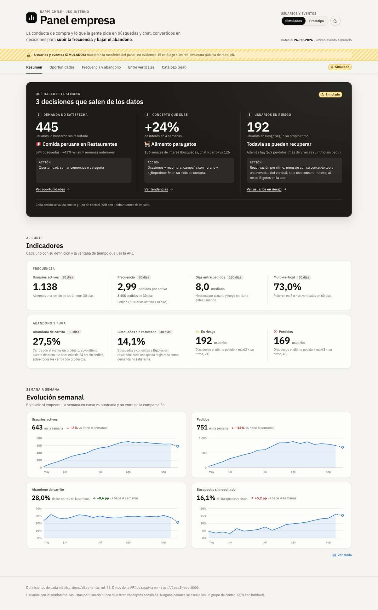
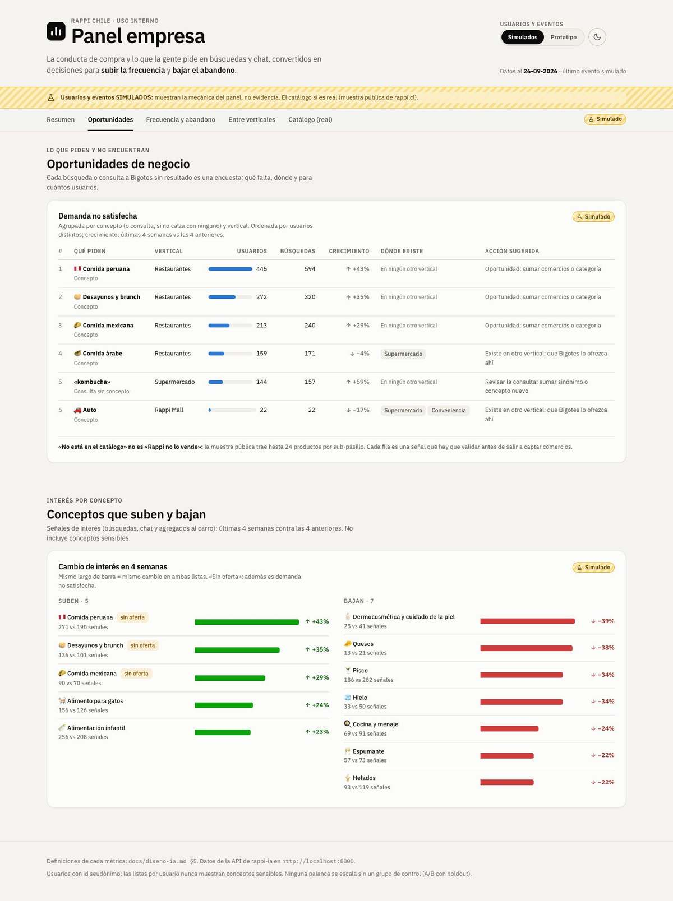
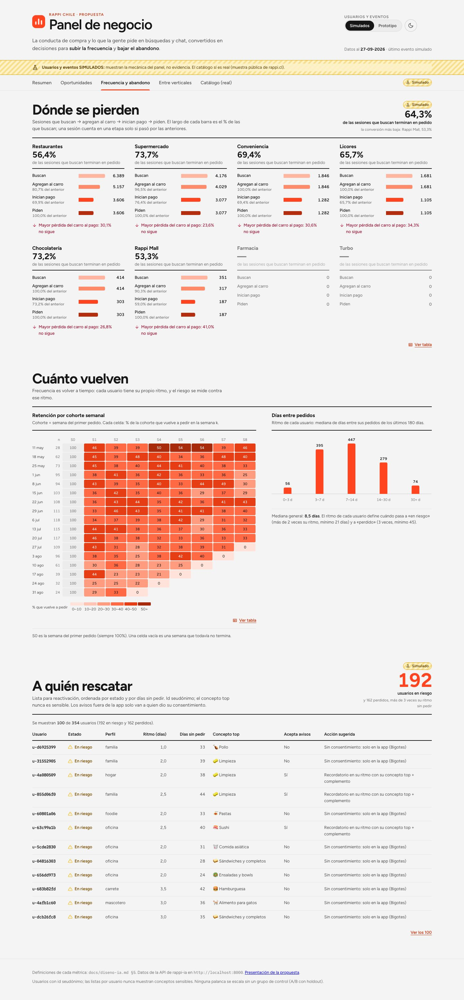
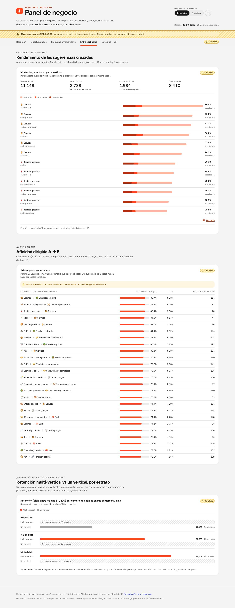
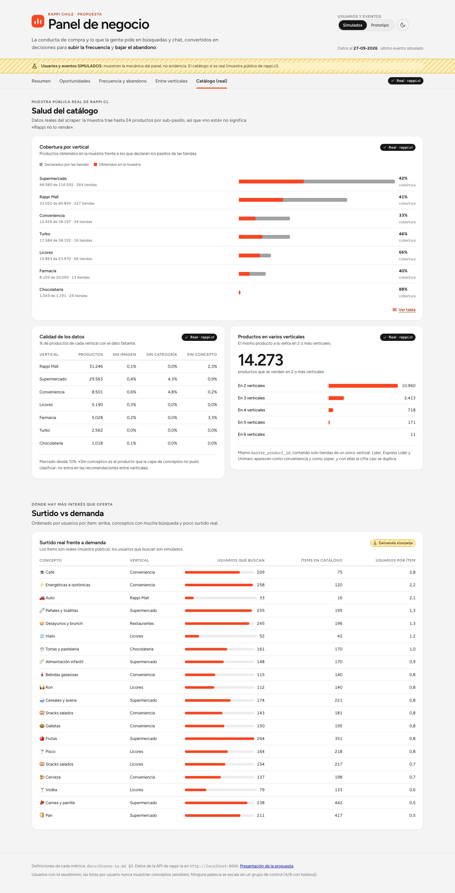
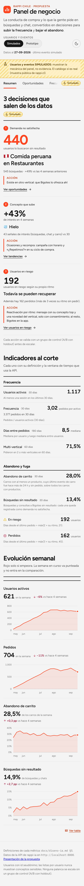
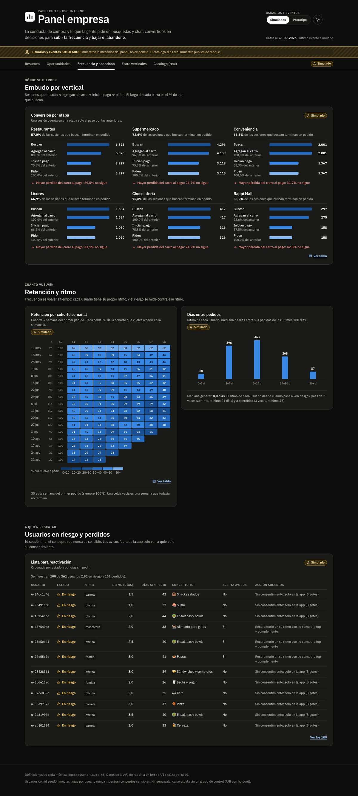

# Panel de negocio (demo)

> Proyecto independiente: no está afiliado a Rappi ni cuenta con su respaldo. Las marcas pertenecen a sus dueños. La etiqueta «Rappi Chile · propuesta» del encabezado es parte de la maqueta.

Panel de demostración que muestra cómo la conducta de compra y lo que la gente pide en búsquedas y chat se pueden convertir en **decisiones para subir la frecuencia y bajar el abandono**:

- tendencias de interés por concepto;
- demanda no satisfecha como oportunidad de negocio (en la simulación, el generador inventa una demanda creciente de «comida peruana» para mostrar cómo se ve una oportunidad; no describe la oferta real de Rappi);
- usuarios en riesgo según su propio ritmo de compra;
- rendimiento de las sugerencias cruzadas de Bigotes entre verticales;
- salud real del catálogo.

Las definiciones de cada métrica y la redacción vienen de [docs/diseno-ia.md §5](../docs/diseno-ia.md#5-panel-para-la-empresa-vale-la-pena). Los datos salen de la API de [`rappi-ia`](../rappi-ia/).

> **Usuarios, eventos y pedidos SIMULADOS.** Se generan con `rappi-ia/src/rappi_ia/events/synth.py` (1.500 usuarios × 20 semanas, semilla 7, `source = 'synthetic'`) y supuestos explícitos. El panel **muestra la mecánica, no evidencia**. Por ejemplo, el simulador asume que quien usa más verticales se va menos, así que esa relación aparece por construcción. La pestaña Catálogo sí usa datos reales: la muestra pública de rappi.cl.

El panel lo dice siempre:

- un aviso fijo arriba que nunca se oculta;
- una insignia de procedencia en la cabecera de cada sección («Simulado», «Prototipo», «Real · rappi.cl» o «Demanda simulada»).

Las fuentes nunca se mezclan: cada respuesta se valida contra la fuente pedida.

La carpeta trae además una página de presentación de la propuesta (`presentacion.html`, en la misma raíz de Vite): problema, propuesta, la red que el catálogo ya comparte entre verticales (`public/presentacion/mapa-multivertical.html`, que se regenera con `rappi-ia multivertical`), arquitectura y resultados, pensada para abrirla antes del panel. Con el servidor de desarrollo arriba está en `http://localhost:5175/presentacion.html`.

## Cómo correrlo

Desde la raíz del repositorio:

1. Levantar la API de `rappi-ia` y esperar a «Application startup complete» (carga los modelos al arrancar). El panel la busca por defecto en `http://localhost:8000`:

   ```bash
   cd rappi-ia
   make serve
   ```

2. En otra terminal, levantar el panel:

   ```bash
   cd dashboard-empresa
   npm ci
   npm run dev          # http://localhost:5175
   ```

La URL de la API se cambia con `VITE_API_URL`, por ejemplo `VITE_API_URL=http://localhost:8001 npm run dev` o en `.env.local`. La API ya acepta peticiones desde `localhost:51xx` (CORS). Para abrir el panel desde el iPhone hace falta `VITE_API_URL` con la dirección del Mac, porque por defecto busca la API en `localhost`.

**Sin la API** el panel igual funciona. Cada consulta que falla, o que tarda más de 30 s, cae a la respuesta guardada en `src/fixtures/`. En ese caso aparece el aviso «Modo sin conexión (datos guardados)», que dice qué consultas fallaron y por qué, y trae un botón *Reintentar*.

| Comando | Qué hace |
|---|---|
| `npm run dev` | Servidor de desarrollo en el puerto 5175 |
| `npm test` | Tests (Vitest + Testing Library, sin red: usan `src/fixtures/`) |
| `npm run lint` | ESLint (reglas de React Hooks 7) |
| `npm run build` | Build de producción en `dist/` |
| `npm run fixtures` | Vuelve a guardar las respuestas de la API en `src/fixtures/` (correr tras `make synth` o una actualización del catálogo) |
| `npm run screenshots` | Regenera `docs/screenshots/` con el Chrome instalado y un Vite propio en el 5198 |

Tests: 80 (Vitest, 30-09-2026). CI en GitHub Actions: lint, tests y build.

## Vistas

Arriba se elige la fuente de usuarios y eventos: **Simulados** o **Prototipo** (las pruebas hechas en `prototipo-app`). Con el prototipo casi todo queda vacío y el panel lo dice en cada bloque, con el mínimo que exige la API. La vista y la fuente quedan en la URL (`?vista=frecuencia&fuente=prototipo`), así que un enlace abre exactamente lo mismo.

### 1. Resumen

Lo primero es **Qué hacer esta semana**, armado desde los datos:

- la demanda no satisfecha con más usuarios;
- el concepto que más sube *y que sí tiene oferta*;
- los usuarios en riesgo, con la palanca de §5 que corresponde a cada uno.

Después vienen los 8 indicadores, cada uno con su definición y la ventana que usa la API: usuarios activos, frecuencia, días entre pedidos, % multi-vertical, abandono de carrito, búsquedas sin resultado, usuarios en riesgo y perdidos.

La serie semanal muestra cuatro curvas:

- usuarios activos;
- pedidos;
- % de abandono de carrito;
- % de búsquedas sin resultado.

La serie compara la última semana completa con la de 4 semanas antes. La semana en curso va punteada y no entra en esa comparación.

Todo el panel se lee como un informe: cada sección abre con su titular numérico (la cifra que se mira primero) a la derecha del título, los bloques van separados por líneas finas en vez de tarjetas, y las tablas llevan cabecera en negrita. En el Resumen, la decisión principal es el titular y las otras dos van en columnas menores.



*Datos simulados: muestran la mecánica, no evidencia.*

### 2. Oportunidades

**Demanda no satisfecha**, ordenada por usuarios. Cada fila trae qué se pide, en qué vertical, cuántos usuarios y búsquedas, el crecimiento, dónde existe y la acción sugerida. El titular suma **búsquedas**, no usuarios: una misma persona aparece en varias filas. El crecimiento dice «nueva» si la demanda solo aparece en las últimas 4 semanas, y «sin actividad en 4 semanas» si ya no se busca. En la simulación, «comida peruana» aparece arriba porque el generador la plantó como antojo creciente. «Dónde existe» usa la misma regla que Bigotes para ofrecer un concepto en otra vertical (al menos 20 productos, y restaurantes solo para lo que se pide hecho). Por eso los 3 productos «peruanos» de Farmacia y Súper, un laxante mal etiquetado, no cuentan, y la acción sugerida es sumar comercios. En la operación real, cada fila sería una señal que hay que validar antes de actuar.

**Conceptos que suben y bajan**: las últimas 4 semanas contra las 4 anteriores. Se marcan los que suben pero no tienen oferta.



*Datos simulados: muestran la mecánica, no evidencia.*

### 3. Frecuencia y abandono

- **Embudo por vertical** (buscan → agregan → inician pago → piden), con la conversión de cada paso y el paso donde más se pierde.
- **Retención por cohorte semanal**, como mapa de calor.
- **Distribución del ritmo de compra.**
- **Usuarios en riesgo y perdidos**: id seudónimo, estado, ritmo, días sin pedir, concepto top no sensible, consentimiento y acción.



*Datos simulados: muestran la mecánica, no evidencia.*

### 4. Entre verticales

- **Sugerencias de Bigotes**: cuántas se mostraron, aceptaron y convirtieron.
- **Afinidad dirigida A → B**: confianza P(B | A), lift y usuarios. Las aristas aprendidas de datos simulados **no las usa el agente**.
- **Retención multi-vertical vs un vertical por estrato**, con el mismo número de pedidos en cada comparación. Descarta la explicación más evidente (quien pide más también usa más verticales), pero no mide causa: eso solo lo da un A/B con grupo de control (holdout). En la simulación la diferencia existe por construcción (ver el aviso de arriba).



*Datos simulados: muestran la mecánica, no evidencia.*

### 5. Catálogo (real)

Sale de la muestra pública real de rappi.cl:

- cobertura: obtenidos vs declarados por vertical;
- calidad: % sin imagen, sin categoría o sin concepto;
- productos presentes en 2 o más verticales.

Aparte va **surtido vs demanda**, marcado «demanda simulada»: cruza el surtido real con la demanda de los usuarios simulados.



*Datos reales de la muestra pública, capturados antes de la descarga completa: las cifras cambian con cada corrida del scraper (resultados vigentes en [README.md#resultados](../README.md#resultados)). El bloque «Surtido vs demanda» usa demanda simulada.*

Todas las vistas tienen versión móvil (sin scroll horizontal; las tablas pasan a tarjetas) y tema claro y oscuro: sigue al sistema y se puede fijar con el botón.

<p>
  
  
</p>

*Resumen en móvil y Frecuencia en tema oscuro. Datos simulados: muestran la mecánica, no evidencia.*

## Cómo se lee

- **Color con significado.** Un solo azul para magnitudes. El rojo queda **solo** para lo que empeora y para el riesgo, y el verde para lo que mejora; siempre van con flecha o ícono y texto, nunca solo por color. El ámbar rayado marca lo simulado.
- **Cada gráfico tiene su tabla.** El botón *Ver tabla* muestra todos los valores. Los gráficos se recorren con teclado: flechas en las series semanales y Tab en las columnas.
- **Accesibilidad.** Pestañas accesibles (← → Inicio Fin) y respeto de `prefers-reduced-motion`.
- **Paletas validadas:** rampas ordinales y secuenciales, y contraste de texto ≥ 4,5:1 en ambos temas.

## Estructura

```text
src/
├── App.jsx                 pestañas, fuente, aviso de procedencia
├── presentacion.js         página de presentación de la propuesta (con presentacion.html y public/presentacion/)
├── lib/                    api.js (API + respaldo), format.js (es-CL), labels.js, hooks
├── components/             tarjeta, tabla, insignias, estados vacío/carga/error
│   ├── charts/             SVG propios: línea, columnas, barras, mapa de calor (sin librerías)
│   └── shell/              encabezado, selector de fuente, tema, pestañas
├── views/<vista>/          una carpeta por vista, con sus transformaciones y tests
├── fixtures/               respuestas guardadas de la API (tests y modo sin conexión)
├── styles/                 estilos
└── test/                   API falsa para los tests de render
scripts/                    update-fixtures.mjs, screenshots.mjs
docs/screenshots/           capturas (en git solo las 7 que usa este README, comprimidas)
```

## Límites conocidos

**Datos simulados.** Los gráficos de usuarios, eventos y pedidos confirman los supuestos del simulador. No sirven para decidir hasta tener datos reales.

**Catálogo como muestra.** El catálogo es la muestra pública: hasta 24 productos por sub-pasillo. Los números de cobertura cambian con cada corrida del scraper, y «no está» no significa «Rappi no lo vende».

**Serie semanal.** `/analytics/weekly` llegó a tardar varios segundos en pruebas anteriores; el 29-09 respondió en menos de 1 s. Si alguna vez pasa de 30 s, el bloque se muestra con datos guardados (y el aviso lo dice).

**La API no entrega todo lo que pide §5.** Falta:

- la ciudad en las oportunidades;
- los cambios de precio del catálogo;
- el abandono de búsqueda.

Además, la lista de riesgo llega con máximo 100 filas, primero los usuarios en riesgo (los más fáciles de recuperar) y después los perdidos. Si en una respuesta no viniera ningún usuario en riesgo habiendo alguno, el panel lo avisa en vez de esconderlo.
