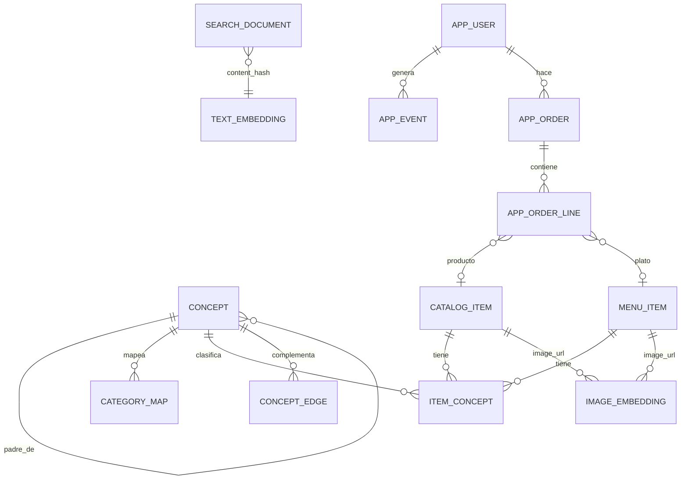

# Diseño: RAG, agente Bigotes y panel para la empresa

> Cómo se conectan el catálogo (scraper), la búsqueda semántica, el agente, el prototipo y un panel de negocio.
> Última actualización: 27-09-2026. Grafo: [diagramas/arquitectura-ia.html](diagramas/arquitectura-ia.html).
> Contexto: [contexto-y-problema.md](contexto-y-problema.md) · Modelo de datos: [ecosistema-rappi.md](ecosistema-rappi.md).
> Las cifras son de datos parciales al 27-09-2026 (la descarga completa sigue en curso) y hay que recalcularlas después del refresh.

## 0. La regla que ordena todo

**Buscar dentro del vertical; entender al usuario a través de los verticales.**

| | Dentro del vertical | A través de los verticales |
|---|---|---|
| **Qué es** | Recuperar productos, platos y tiendas | Saber qué le interesa a la persona |
| **Dónde vive** | `search_documents`, particionada por vertical, con un índice vectorial por partición | Perfil de intereses expresado en **conceptos** (capa 2), compartidos por todos los verticales |
| **Por qué** | Quien está en Licores quiere resultados de Licores: mezclar verticales baja la precisión | El problema del proyecto es que hoy lo que haces en un vertical no cambia los otros |

La recomendación cruzada se arma así: interés del usuario (concepto) → **arista de complemento** (cerveza → snacks) → búsqueda **en el índice del otro vertical**. El puente entre verticales es el concepto, no el índice.

Esto corrige una contradicción de los documentos anteriores. Presentaban el silo como "principio de diseño", cuando es **el problema** que el prototipo busca resolver. El aislamiento sigue siendo una regla de búsqueda, no un límite del modelo.

## 1. Cómo se diseña el RAG

```text
OFFLINE (después de cada refresh)
catálogo (capa 1) ─┬─► documentos de búsqueda por vertical ─► embeddings de texto (e5, caché por content_hash) ─► HNSW por partición
                   ├─► imágenes de productos y platos ─► embeddings CLIP ─► image_embeddings
                   └─► mapeo a conceptos (categoría → reglas → embeddings) ─► item_concepts + aristas

ONLINE (cada consulta)
texto / voz→texto / foto ─► entender (intención, vertical, conceptos, filtros)
   ─► recuperar en el vertical, con filtros duros dentro de cada lista:
      léxico (tsvector) + vectorial (coseno) [+ imagen] ─► fusión RRF ─► refuerzo por concepto
   ─► precios y stock actuales por SQL (nunca desde el embedding)
   ─► componer (plantilla o LLM, en JSON) ─► verificar ─► responder + registrar evento
```

Decisiones:

- **Documentos.** Hay uno por producto, plato o tienda, y por vertical. La tabla `search_documents` y el SQL que la arma (`build_search_documents`) ya existen, con nombre, marca, presentación, categoría y descripción. Hoy solo está poblada para supermercado, chocolatería y restaurantes, del 24-09, y sin embeddings: se regenera al terminar la descarga en curso.
- **Sin dividir en trozos.** Son textos cortos: mediana ≈ 230 caracteres, y ≈ 320 en mall. Unos 300 documentos, casi todos de mall, superan los 2.000 caracteres y se truncan en 512 tokens. Por eso el nombre va primero.
- **El precio no va en el texto que se embebe.** Cambia en cada corrida y obligaría a volver a embeber. Se lee por SQL (`price_snapshots`, `menu_price_snapshots`).
- **Caché por `content_hash`.** Los vectores se guardan en una tabla propia `text_embeddings(content_hash, embedding_model, embedding)`. Así, un texto repetido en varios verticales se embebe una sola vez y se copia a `search_documents.embedding`, donde vive el HNSW de cada partición. Además, si el texto no cambió, el `refresh` conserva el vector de cada fila (`_UPSERT` en `rappi-scraper/src/rappi_scraper/storage/search.py`).
- **Híbrido con RRF (k = 60)** en lugar de solo vectores:
  - lo léxico acierta marcas y nombres exactos ("Heineken 470");
  - lo vectorial acierta necesidades ("algo para el carrete", "remedio para la guata").
  - El léxico usa una columna de texto sin tildes ni ñ (`unaccent` + español), en el documento y en la consulta: "panales" encuentra "pañales".
- **Filtros duros dentro de cada recuperador, antes de fusionar.** Precio máximo, en stock y vertical:
  - en el léxico, con un JOIN a los precios vigentes;
  - en el vectorial, con un pool amplio de candidatos (k = 200, o `hnsw.iterative_scan` de pgvector 0.8);
  - se compara contra el precio mínimo en stock entre las tiendas del vertical.
  - Si el filtro deja la lista vacía, Bigotes lo dice ("no hay bajo $X; el más barato cuesta $Y") y **no** registra demanda no satisfecha.
- **"Sin resultado" bien definido.** La búsqueda vectorial siempre devuelve vecinos, así que "no encontrar" necesita una regla. Hay sin resultado cuando se cumplen las tres:
  - lo léxico no encuentra coincidencias;
  - el coseno máximo de e5 queda bajo τ del vertical;
  - ningún producto del vertical comparte concepto con la consulta.
  - τ se calibra por vertical con consultas negativas del set de evaluación (productos que no existen), buscando una precisión ≥ 0,9.
  - Se guarda qué condición se cumplió. Si el concepto cae en un sub-pasillo truncado por el tope de 24, se marca "posible falta de muestra".
- **Reranker:** no por ahora. Se agrega (p. ej. `bge-reranker-v2-m3`) solo si la evaluación lo justifica, porque suma latencia y otro modelo.
- **Evaluación antes de elegir.** Un set de preguntas por vertical, con juicios guardados en el repo, que incluye consultas negativas y consultas escritas sin tildes. Métricas nDCG@10, Recall@10 y MRR, comparando léxico, vectorial e híbrido. El modo por defecto sale de ahí.
- **Dos audiencias, un solo núcleo:**
  - Bigotes, para clientes, en el prototipo;
  - más adelante, preguntas del equipo interno (Marketing, Producto, BI), que usan las mismas herramientas más consultas SQL de análisis.

## 2. Qué datos se relacionan y cuáles no

### Se relacionan

| Relación | Llave | Confianza | Uso |
|---|---|---|---|
| Producto ↔ oferta de tienda ↔ vertical | `master_product_id`, `store_id` | Exacta | Catálogo, precios y disponibilidad |
| Mismo producto en varios verticales | `master_product_id` | Exacta, pero **inflada** por tiendas con doble etiqueta (Lider, Express Lider y Unimarc aparecen como conveniencia y como súper) | Contando solo tiendas de un único vertical, ≈ 3.300 productos cruzados reales, frente a ≈ 6.370 con la doble etiqueta. La consulta queda en el repo como vista |
| Producto o plato ↔ concepto | `item_concepts` (curado, reglas o embeddings) | Probabilística: se guardan `method`, `confidence` y `model_version` | El puente entre verticales |
| Plato de restaurante ↔ producto del súper | **Solo vía concepto** (pizza ↔ pizza congelada) | Probabilística | "Pizza hoy en restaurante o para el fin de semana del súper" |
| Marca de producto entre verticales | `trademark` normalizado | Media: solo el 35% de los productos trae marca | Análisis de surtido |
| Usuario ↔ concepto | Eventos → perfil con decaimiento | Hoy simulada | Recomendaciones y panel |
| Consulta ↔ concepto ↔ vertical | Entendimiento de la consulta | Probabilística | Tendencias y demanda no satisfecha |
| Foto ↔ producto | Espacio CLIP (imagen ↔ imagen, texto ↔ imagen) | Aproximada | Buscar por foto |

### No se relacionan (o no se deben mezclar)

- **Precios entre verticales** si no son el mismo `master_product_id` y la misma presentación.
- **Plato y producto por id:** no comparten llave; solo el concepto.
- **Cadenas entre verticales.** `brands` no identifica cadenas: cubre ~⅓ de las tiendas, casi siempre con una tienda por marca, y no incluye Lider ni Unimarc. Por nombre, cadenas como Unimarc, Cruz Verde u OXXO sí aparecen en 2 o 3 verticales. El nombre normalizado sirve para analizar surtido, pero no como puente de recomendación: ese puente es el concepto.
- **"No está en el catálogo" ≠ "Rappi no lo vende":** la muestra pública trae hasta 24 productos por sub-pasillo. La demanda no satisfecha es una **señal que hay que validar**, no una prueba.
- **Vectores de modelos distintos:** e5 y CLIP viven en espacios distintos. Nunca se comparan entre sí; se fusionan por ranking (RRF), no por puntaje.
- **Datos simulados con datos reales:** cada usuario, evento y pedido lleva `source` (`synthetic` o `prototype`). El panel los muestra marcados y nunca los suma con métricas reales.

### Privacidad

- **Audio y fotos del usuario:** no se guardan. Solo queda el texto transcrito o los conceptos detectados.
- **Consultas guardadas:** se guardan con los datos personales redactados (RUT, teléfono, correo, dirección) y se retienen 90 días. Después solo quedan agregados por concepto.
- **"Olvidar":** borra o anonimiza los eventos de ese concepto (o de todo el usuario), no solo el perfil.
- **Avisos:** "avisar cuando llegue" y los mensajes de reactivación requieren consentimiento explícito.
- **En el panel:** los usuarios aparecen con un id seudónimo. Las listas a nivel de usuario nunca incluyen conceptos sensibles.

## 3. Lógica de embeddings multimodal

| Entrada | Qué se hace | Modelo (local, sin costo por uso) | Dónde queda |
|---|---|---|---|
| **Texto** (catálogo y consultas) | Embedding con prefijos `passage:` (documentos) y `query:` (consultas y etiquetas de conceptos) | `intfloat/multilingual-e5-base` (768 dimensiones, máx. 512 tokens) | Caché `text_embeddings` → `search_documents.embedding`, con un HNSW por partición |
| **Imagen del catálogo y de los platos** | Embedding de la foto del producto o plato | `sentence-transformers/clip-ViT-B-32`, pesos de OpenAI (512 dimensiones) | `image_embeddings` (solo el vector; la imagen no se guarda) |
| **Foto del usuario** | 1. Conceptos por clasificación *zero-shot* contra "una foto de {concepto}", con una clase "otro". Un concepto solo cuenta con probabilidad ≥ 0,5 y un margen ≥ 0,2 sobre el segundo. 2. Productos visualmente parecidos en el vertical | CLIP (imagen) + `sentence-transformers/clip-ViT-B-32-multilingual-v1` (texto en español al mismo espacio; solo está alineado con los pesos de OpenAI; máx. 128 tokens) | No se guarda. Se registran los conceptos detectados, nunca los sensibles |
| **Voz** | **No se embebe el audio.** Voz → texto → mismo camino que el texto | Whisper vía `faster-whisper`: modelo `small`, `int8` en CPU, `language='es'`, `vad_filter=True`, `condition_on_previous_text=False` | Se guarda el texto (redactado) y la modalidad `voz` en el evento |

**Control de calidad de la voz:**
- Se descarta el audio si `no_speech_prob` > 0,6 o si el texto está en una lista de alucinaciones conocidas de Whisper (p. ej. "Subtítulos realizados por la comunidad de Amara.org").
- Confianza = `exp(avg_logprob)`. Si es < 0,5 o si `compression_ratio` > 2,4, Bigotes pregunta "¿Dijiste…?".

**Cómo se combinan:**
- Toda entrada termina en (vertical, conceptos, texto y, si hay foto, un vector de imagen).
- Cada fuente aporta una lista ordenada (léxica, vectorial de texto, vectorial de imagen) y se fusionan con RRF.
- Los conceptos detectados en la foto refuerzan los resultados que comparten concepto.
- Cada vector guarda su `embedding_model`.

**¿Por qué modelos locales?** No hay claves de API configuradas, los datos no salen del Mac y el costo es cero. Se pueden cambiar sin rehacer el diseño: el caché se separa por modelo.

## 4. Comportamiento del agente (Bigotes)

**Flujo por turno:** entender → decidir herramienta(s) → recuperar → componer → verificar → registrar.

**Herramientas:**
- `buscar_productos(vertical, consulta, conceptos, precio_max)`
- `buscar_por_foto(imagen, vertical?)`
- `recomendar_complementos(conceptos, vertical_actual)`
- `detalle(entidad)`
- `historial_precio(producto)`

**Reglas de conducta:**

1. **Solo habla de lo que existe.**
   - Cada producto citado viene de una herramienta, y los precios salen de SQL.
   - El LLM recibe solo campos de una lista blanca: id, nombre, marca, presentación y precio.
   - Las descripciones de los comercios van delimitadas y marcadas como datos, nunca como instrucciones.
   - En el texto, los productos se citan con marcadores (`{p1}`) que reemplaza el código.
   - El verificador rechaza ids no recuperados y cifras, precios o atributos ("sin alcohol", "el más barato") que no salgan de esos campos.
   - Los botones (`actions`) los arma siempre el código.
2. **Respeta el vertical en que estás.** La respuesta principal sale de ese vertical. Lo cruzado va aparte y marcado "De otra tienda", con su razón visible ("porque llevas cerveza").
3. **Máximo una sugerencia cruzada por respuesta**, una por tema por sesión y un tope diario. Nada de urgencias falsas.
4. **Honestidad.** Si no encuentra (según la definición del §1), lo dice y registra **demanda no satisfecha** (consulta, vertical, conceptos y condición). Esa es la materia prima de las oportunidades de negocio.
5. **Aclara, no adivina.** Si la intención es ambigua entre verticales, hace una sola pregunta con opciones.
6. **Categorías sensibles y restringidas.**
   - a. **Sensibles:** los conceptos marcados `sensitive` (medicamentos, salud sexual, bienestar sexual, tabaco y vapeo). **Restringidos por edad:** alcohol, tabaco, vapeo y adultos. Un producto es restringido si `is_alcoholic` o `age_restricted` es verdadero, o si su concepto es `age_restricted`.
   - b. **Nunca por iniciativa propia.** Bigotes no sugiere un producto sensible, ni como sugerencia cruzada, recompra, reactivación o alerta. Las aristas hacia esos conceptos se ignoran. El alcohol se puede sugerir como complemento (cerveza con pizza), siempre con +18.
   - c. **Fuera del perfil.** Los conceptos sensibles no entran al perfil, no se muestran en "Aprendiendo de ti" y no sirven de origen ni de razón de una sugerencia.
   - d. **Farmacia.** No se sugieren medicamentos a partir de síntomas: solo se muestran los productos que el usuario nombra, y se recomienda consultar a un químico farmacéutico.
   - e. **Productos +18.** Siempre llevan el recordatorio. El tabaco y el vapeo solo se muestran si se piden por nombre, porque en Chile su publicidad está prohibida (Ley 20.105).
7. **Memoria transparente.** Intereses por concepto con decaimiento (vida media de 14 días), visibles ("Aprendiendo de ti") y borrables ("Olvidar"). En modo "Rappi hoy" no aprende.
8. **El código decide y el LLM solo redacta.**
   - Sin clave de API, Bigotes responde con plantillas y las mismas reglas. Con `ANTHROPIC_API_KEY`, Claude redacta el texto en JSON estricto sobre lo recuperado.
   - Entender la consulta: hoy son reglas + embeddings. Jev (el modelo "System One" de TypeSafe: juicios tipados con probabilidad y baja latencia) queda como adaptador para esta etapa cuando haya clave.

**Contrato de respuesta.** Amplía el de `prototipo-app/src/assistant/brain.js` (`text`, `products`, `stores`, `reason`, `actions` y `tags`) sin romperlo:
- `reason` sigue en el primer nivel;
- `products` tiene la forma de `prototipo-app/src/data/catalog.js` (`id`, `name`, `price`, `img`, `store`…);
- `suggestion` agrega la sugerencia cruzada, que el cliente muestra como "De otra tienda";
- `vertical` usa los códigos del backend. El cliente los traduce a los ids del prototipo: supermercado → grocery, licores → liquor, farmacia → pharmacy, mall → retail, conveniencia/turbo → express, chocolateria → chocolates.

```json
{ "text": "…", "products": [], "stores": [], "reason": "Porque llevas 🍺 cerveza",
  "suggestion": { "reason": "Porque llevas 🍺 cerveza", "vertical": "supermercado", "concept": "snacks-salados", "products": [] },
  "actions": [], "intent": { "kind": "buscar", "vertical": "licores", "concepts": ["cerveza"], "confidence": 0.82 },
  "tags": ["cerveza"], "unmet": false, "age_notice": true }
```

## 5. Panel para la empresa: ¿vale la pena?

**Sí, si se enfoca en decisiones y no en gráficos.** Las conversaciones y búsquedas son una encuesta continua de lo que la gente quiere. El panel convierte eso, junto con la conducta de compra, en acciones para **subir la frecuencia y bajar el abandono**.

**Métricas** (definidas en SQL en `rappi-ia`):

| Métrica | Definición |
|---|---|
| Usuario activo | Al menos una sesión en los últimos 30 días |
| Frecuencia | Pedidos / usuarios activos (30 días). Días entre pedidos: mediana por usuario y luego mediana entre usuarios |
| Abandono de carrito | Carros (`cart_id`) con al menos un producto, cuyo último evento de carro fue hace más de 24 h y sin pedido, sobre todos los carros con productos. Se cuenta una vez por carro |
| Abandono de búsqueda | Búsquedas sin clic ni agregado al carro y sin otra búsqueda con clic en 2 minutos, sobre el total de búsquedas |
| Ritmo del usuario | Mediana de los intervalos entre pedidos en 180 días. Con solo 2 pedidos, el único intervalo, acotado entre 7 y 30 días |
| En riesgo / perdido | En riesgo: días desde el último pedido > máx(2 × ritmo, 21). Perdido: > máx(3 × ritmo, 45). Los usuarios con 1 pedido van aparte ("sin segunda compra") |
| Retención | Hizo al menos un pedido entre los días 61 y 120 desde su primer pedido |
| Usuarios multi-vertical | Pidieron en 2 o más verticales en 60 días. Su retención se compara **a igual número de pedidos y antigüedad**: quien pide más cae más en dos verticales y además retiene más, así que la comparación directa no mide el efecto |
| Sugerencia aceptada / convertida | Aceptada: el producto sugerido se agregó al carro en la sesión. Convertida: se pidió en ≤ 24 h |

**Vistas:**

1. **Oportunidades.**
   - Demanda no satisfecha, agrupada por concepto, vertical y ciudad: cuántos usuarios la piden, su tendencia y una acción sugerida (sumar comercios o categoría, sinónimo de búsqueda, o avisar cuando llegue).
   - Conceptos que suben: últimas 4 semanas contra las 4 anteriores.
2. **Frecuencia y abandono.** Embudo por vertical, retención por cohorte semanal, distribución de días entre pedidos y lista de usuarios en riesgo (id seudónimo) con la acción sugerida.
3. **Entre verticales.** Afinidad concepto → concepto y rendimiento de las sugerencias de Bigotes (mostradas, aceptadas, convertidas, ignoradas).
4. **Catálogo (muestra pública real).** Cobertura (obtenidos / declarados) por vertical y concepto, calidad (sin imagen o sin categoría) y cambios de precio. La comparación surtido vs. demanda va aparte, marcada "demanda simulada".

**Aristas aprendidas** (alimentan al agente con `method = 'coocurrencia'`):
- Usan la confianza dirigida P(B | A). El lift > 1 es solo un filtro: el lift es simétrico y no da dirección.
- Requieren al menos 30 usuarios distintos con A y B, y se suavizan hacia la arista curada.
- No cuentan co-ocurrencias en que B se agregó desde una sugerencia de Bigotes, para no retroalimentarse.
- Las aprendidas de datos `synthetic` quedan marcadas y **el agente no las usa**: solo se ven en el panel.
- Nunca se aprenden aristas hacia conceptos sensibles.

**Palancas que salen de estos datos:**

| Palanca | Señal | Acción | Métrica que mueve |
|---|---|---|---|
| Recompra por ciclo | Días entre compras del mismo concepto (pañales, café, alimento de mascota) | "¿Repetimos?" en el momento justo | Frecuencia |
| Rescate de carrito | Carro abandonado | Recordatorio con el carro y un complemento. Sin descuento automático | Abandono de carrito |
| Reactivación por ritmo | Usuario en riesgo según su propio ritmo | Mensaje con su concepto top y una novedad del vertical (con consentimiento) | Churn |
| Segunda vertical | Usuario de un solo vertical | Sugerencia cruzada de mayor confianza | % multi-vertical y retención |
| Ocasiones | Picos por día u hora (viernes: carrete; domingo: asado) | Campañas con horario | Frecuencia |
| Demanda no satisfecha | Consultas sin resultado | Captar comercios o categorías; avisar a quien lo pidió (con consentimiento) | Conversión y oportunidades |
| Búsquedas fallidas | Reformulaciones sin clic | Sinónimos y mapeo de conceptos | Abandono de búsqueda |
| Bajas de precio | `price_snapshots` real, sobre productos que el usuario compra | Alerta de precio | Frecuencia |

Ninguna palanca usa conceptos sensibles.

**Límites honestos:**

- Hoy los usuarios y eventos son **simulados**, generados con semilla y con supuestos explícitos. Por ejemplo, el generador asume que quien usa más verticales abandona menos. El panel **muestra la mecánica, no evidencia**: con datos reales, esa relación se mide y puede no cumplirse.
- Cualquier palanca se valida con un grupo de control (A/B con *holdout*) antes de escalar. El efecto causal de "Segunda vertical" se mide solo así, no con la comparación de retención.

## 6. Modelo de datos nuevo



Notas del modelo:

- **Platos estándar:** `dish_concepts` se reemplaza por `item_concepts`. Un plato y un producto del súper se conectan al compartir concepto.
- **Eventos:** `APP_EVENT` lleva `session_id` (una sesión termina tras 30 minutos sin actividad) y `cart_id` en los eventos de carro (`cart_add`, `cart_remove`, `checkout_start`, `order_placed`).
- **Líneas de pedido:** `APP_ORDER_LINE` puede apuntar a un producto o a un plato. El ERD anterior solo permitía productos.
- **Procedencia:** todo dato inferido guarda `method` (`curado`, `llm`, `regla`, `embedding`, `coocurrencia`), `confidence`, `model_version` y fecha. Los datos de usuario guardan `source`.
- **H3:** queda para después, porque no lo necesita ninguna vista de este plan.

## 7. Etapas

| Etapa | Entrega | QA |
|---|---|---|
| 0. Diseño | Este documento, el grafo y docs sin contradicciones | Validación Archify y revisión adversarial |
| 1. Conceptos (capa 2) | `concepts`, `category_map`, `item_concepts`, `concept_edges` y `rappi-ia concepts` | Cobertura ≥ 85% y precisión revisada por muestreo |
| 2. Embeddings y búsqueda híbrida | `embed-text`, `embed-images`, `retrieve()` y set de evaluación | nDCG, Recall y MRR: léxico vs vectorial vs híbrido; calibración de τ |
| 3. Agente | Bigotes en el backend (texto, foto, voz) | Tests de reglas de conducta y escenarios |
| 4. API | FastAPI | Tests de endpoints |
| 5. Eventos y analítica | Tablas, generador simulado y consultas | Tests con datos controlados |
| 6. Prototipo conectado | Cliente API con respaldo local, eventos y bugs corregidos | Vitest y prueba en el navegador |
| 7. Panel empresa | `dashboard-empresa/` | Vitest y chequeo visual |
| 8. Cierre | CI, docs y corrida completa post-refresh | CI en verde |
