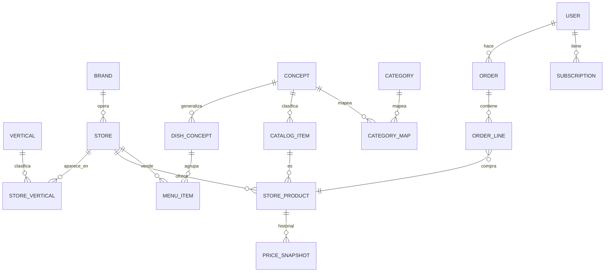

# Ecosistema Rappi Chile: research y modelo de datos

> Cómo está armado el ecosistema de Rappi en Chile, cómo modelan sus datos las super-apps comparables y qué modelo de datos proponemos para conectar todos los servicios y verticales.
> Research con fuentes públicas al 26-09-2026; última actualización: 27-09-2026. No tenemos datos internos de Rappi: todo lo que no tiene fuente es **inferencia** y está marcado así.
> Contexto del proyecto: [contexto-y-problema.md](contexto-y-problema.md) · Diseño del RAG, agente y panel: [diseno-ia.md](diseno-ia.md).

## Resumen

1. **Rappi es una sola cuenta con muchos servicios.** La suscripción **Rappi Pro / Pro Black** conecta verticales (envío gratis en restaurantes, market, farmacia y Turbo) y concentra más del 60% de los pedidos. Alrededor hay Turbo, Rappi Travel, RappiFavor, retiro en tienda, Rappi Ads y el Portal Partners para comercios.
2. **Nuestro diseño coincide con la industria:** Instacart movió su búsqueda híbrida a Postgres + pgvector; iFood usa un índice por vertical con fusión RRF; Uber Eats separa índices de restaurantes y de retail.
3. **Nos faltan cuatro piezas** para modelar el ecosistema: conceptos de plato, una taxonomía común con mapeo a las categorías de Rappi, trazabilidad de datos derivados y geografía (H3).
4. **Decisión: solo Rappi por ahora.** Uber Eats y PedidosYa están detrás de protección anti-bots (Cloudflare); scrapearlas implica evadirla y sube el riesgo legal.

---

## 1. El ecosistema de Rappi en Chile

### Servicios

| Servicio | Qué es | Estado en Chile | Fuente |
|---|---|---|---|
| **Verticales de catálogo** | Restaurantes, supermercado, conveniencia, Turbo, Rappi Mall, farmacia, licores, chocolatería | Activos | rappi.cl (nuestro scraping, sep-2026) |
| **Rappi Pro / Pro Black** | Suscripción mensual: envío gratis en restaurantes, market, farmacia y Turbo; ≥20% de descuento en tarifa de servicio; "Pro Rewards"; Black suma prioridad, soporte VIP, créditos en Rappi Travel y beneficios con partners (Cabify, LATAM Pass, Marriott, Iberia, ChatGPT Go). CLP 4.990 / 7.990 | Activo; reemplazó a Rappi Prime en feb-2024. >60% de los pedidos son de miembros Pro | [pro.rappi.com/chile](https://pro.rappi.com/chile); [chocale.cl, feb-2024](https://chocale.cl/2024/02/rappi-pro-rappi-pro-black-membresias-rappi-prime-chile/); El Dínamo, ago-2025 |
| **Turbo** | Market en ~10 min desde dark stores; Turbo Restaurantes en ~15 min | Activo en 5 ciudades; 20% de los pedidos donde opera; 9 dark stores, plan de 5 más al 2027 | La Tercera, 19-sep-2026; El Dínamo, ago-2025 |
| **Rappi Travel** | Vuelos, hoteles, autos, seguros, tours | Activo (travel.rappi.cl) | [chocale.cl, feb-2022](https://chocale.cl/2022/02/rappi-travel-venta-vuelos-hoteles/) |
| **RappiFavor / Antojo** | "Compra o lleva lo que sea" | Probablemente activo; no confirmado para 2025–26 | rappi.cl/p/rappifavor |
| **Retiro en tienda** | Pickup activable por el comercio | Activo | [merchants.rappi.com](https://merchants.rappi.com/es-cl/recoger-en-tienda) |
| **Rappi Ads** | Retail media: anuncios en la app, audiencias, clean rooms; campañas desde el Portal Partners | Activo para comercios en Chile | [produ.com, oct-2025](https://www.produ.com); merchants.rappi.com/es-cl |
| **Portal Partners / Rappi Aliados** | Gestión de menú/catálogo, promociones, Ads, reportes, "RappiScore" (calidad) y métricas operativas | Activo | merchants.rappi.com/es-cl |
| **Promociones bancarias y de partners** | Descuentos mensuales con bancos (p. ej. Banco de Chile), cross-promo con Cabify | Activas 2025 | promos.rappi.com/chile |
| **RappiCard (Itaú)** | Tarjeta de crédito con cashback | **Descontinuada** (sin nuevas tarjetas desde dic-2024; cashback terminó ene-2025) | T13, 27-dic-2024 |
| **RappiPay (Chile)** | Pagos QR y billetera | Lanzada en 2018; sin rastro actual (probablemente inactiva) | DF, dic-2018 |

**No encontrado para Chile:** reservas, marcas propias de supermercado, gift card propia de Rappi, vínculo Amazon Prime ↔ Rappi Pro (solo México).

### Cómo se conectan

- **Hechos:** una sola cuenta y app para todos los verticales; los beneficios Pro aplican transversalmente y con partners externos. Los comercios usan Rappi Aliados (recibir pedidos) y el Portal Partners (catálogo, promociones, Ads, métricas). Los repartidores son independientes bajo la Ley 21.431 (~6.500 activos, ~20 pedidos/día cada uno según El Dínamo, ago-2025).
- **Tecnología (pública):** hacia 2021 usaban Snowflake, Fivetran, Amplitude y Looker, con más de 1.000 tipos de eventos ([rakam.io, 2021](https://rakam.io/blog/rappi-case-study)). Forbes (nov-2024) describe búsqueda y buena parte del catálogo impulsados por IA. El rediseño de ene-2025 trajo búsqueda con IA, recomendaciones "filtradas por categoría", favoritos unificados y ofertas diarias personalizadas ([marketing4ecommerce.cl, ene-2025](https://marketing4ecommerce.cl/rappi-chile-inteligencia-artificial-social/)).
- **Sobre los silos de recomendación:** no hay nada público que lo confirme o lo desmienta. "Recomendaciones filtradas por categoría" es coherente con silos por vertical; los favoritos unificados y la búsqueda transversal sugieren al menos algunas superficies compartidas (inferencia).

### Escala en Chile

23 ciudades, más de 10.000 restaurantes, ~1 millón de pedidos al mes (El Dínamo, ago-2025). Chile es el 6.º mercado de Rappi de 9; rentable cinco trimestres seguidos; crecimiento fuerte en regiones (Temuco +176%, Puerto Montt +132%) (La Tercera, sep-2026). En preferencia de usuarios Rappi es tercero (5,6%) detrás de PedidosYa (34,4%) y Uber Eats (23,9%) (encuesta AIM 2024, fuente secundaria).

---

## 2. Cómo modelan sus datos las super-apps

| Patrón | Quién lo usa | Qué significa para nosotros |
|---|---|---|
| **Producto maestro ≠ oferta de tienda** | Instacart ("product" universal vs "item" por tienda, 2021), DoorDash (catálogo vs inventario), Meituan (SKU del comercio vs producto estándar, 2021) | Ya lo tenemos: `catalog_items` vs `store_products` + `price_snapshots` |
| **Conceptos de plato** | Meituan (nombre de plato estándar que agrupa decenas de miles de variantes; 300+ subcategorías), Swiggy (300+ familias de platos), Uber Eats (grafo cocina → plato) | **Nos falta:** agrupar platos equivalentes de distintos restaurantes |
| **Dos taxonomías + mapeo** | Meituan (capas objetivas compartidas + categoría comercial por negocio), DoorDash (taxonomía retail L1–L4, 2026) | **Nos falta:** una taxonomía común y estable, mapeada a los pasillos/categorías de Rappi que cambian |
| **Trazabilidad de datos derivados** | Instacart (prioridad de fuente por atributo), DoorDash ("jurados" de LLM que votan etiquetas) | **Nos falta:** registrar fuente, método, modelo y confianza de cada dato inferido |
| **Precios como hechos históricos** | Instacart (disponibilidad como probabilidad), práctica general | Ya lo tenemos: snapshots por corrida |
| **Índices de búsqueda por vertical** | Uber Eats (un modelo de embeddings, índices separados de restaurantes y retail, 2025), iFood (índice por unidad de negocio + intención + RRF + HNSW, 2026) | Ya lo tenemos: particiones por vertical |
| **Búsqueda híbrida en Postgres + pgvector** | Instacart (reemplazó Elasticsearch y FAISS, 2025) | Valida el stack elegido |
| **Geografía de primera clase** | iFood y Uber (celdas H3 para cobertura de despacho) | **Nos falta:** celda H3 por tienda |
| **Personalización entre verticales** | DoorDash ("memoria unificada del consumidor", 2026), Grab (modelo base de usuario entre comida, movilidad y finanzas, 2025) | La industria tiende a cruzar verticales. Mantener el aislamiento como **regla de búsqueda**, no como límite del esquema, para poder cruzar en análisis |

Fuentes principales: [Instacart catálogo (2021)](https://company.instacart.com/how-its-made/the-story-behind-an-instacart-order-part-1-building-a-digital-catalog), [Instacart búsqueda en Postgres (2025)](https://company.instacart.com/tech-innovation/how-instacart-built-a-modern-search-infrastructure-on-postgres), [Uber delivery search (2025)](https://www.uber.com/blog/evolution-and-scale-of-ubers-delivery-search-platform), [iFood búsqueda (2026)](https://tech.ifood.com.br/engenharia/como-funciona-a-busca-do-ifood/), [Meituan producto (2021)](https://tech.meituan.com/2021/09/02/meituan-commodity-nlp-practice.html), [Meituan grafo de comida (2021)](https://tech.meituan.com/2021/05/27/food-knowledge-graph.html), [DoorDash grafo de productos (2024)](https://careersatdoordash.com/blog/building-doordashs-product-knowledge-graph-with-large-language-models/), [Grab user foundation model (2025)](https://engineering.grab.com/user-foundation-models-for-grab), [schema.org MenuItem](https://schema.org/MenuItem), [GS1 GPC](https://www.gs1.org/sites/default/files/gpc_development_and_implementation_0.pdf). Algunas páginas de DoorDash, Swiggy y Delivery Hero no se pudieron abrir y se citan desde extractos.

---

## 3. Modelo de datos del ecosistema (propuesta)

Tres capas. La primera ya existe; la segunda es la mejora que proponemos; de la tercera, usuarios, eventos y pedidos tendrán tablas con datos simulados (27-09-2026) y el resto queda solo como diseño hasta tener datos internos.

### Capa 1: contenido público (existe hoy, `rappi-scraper`)

`verticals`, `brands`, `stores`, `store_verticals`, `aisles`, `categories`, `catalog_items`, `store_products`, `price_snapshots`, restaurantes y menús (`restaurant_details`, `cuisines`, `menu_sections`, `menu_items`, `menu_price_snapshots`), `search_documents` particionado por vertical.

### Capa 2: mejoras al esquema (se pueden llenar con datos públicos)

| Mejora | Qué agrega | Para qué |
|---|---|---|
| **`concepts`** (taxonomía común) | Árbol propio y estable de conceptos ("lácteos > yogur", "comida > pizza"), enlazable después a Google Product Taxonomy | Análisis entre verticales que no dependa de cómo cada tienda nombra sus pasillos |
| **`category_map`** | Mapeo categorías/pasillos de Rappi → `concepts`, versionado | Las categorías de Rappi cambian; el concepto no |
| **`dish_concepts`** | Plato estándar ("pizza napolitana", "sushi roll acevichado") agrupando `menu_items` de distintos locales, vinculado a `concepts` | Comparar platos y precios entre restaurantes; conectar "pizza" de restaurante con pizza congelada del súper |
| **Trazabilidad** en todo dato inferido | Columnas `source`, `method` (`curado`, `llm`, `regla`, `embedding`, `coocurrencia`; ver [diseno-ia.md](diseno-ia.md#6-modelo-de-datos-nuevo)), `model_version`, `confidence`, `valid_from` en mapeos, etiquetas y agrupaciones | Poder auditar y rehacer lo que generen LLM, Jev o reglas |
| **Geografía H3** | `h3_cell` (y comuna) en `stores` | Análisis por zona y, más adelante, cobertura de despacho |

Las etiquetas de la capa 2 (conceptos, platos estándar, atributos como "vegano") se generan offline con reglas + embeddings (y, si hay clave, LLM o Jev, el modelo de juicios tipados de TypeSafe), siempre con trazabilidad. Es el "enriquecimiento del catálogo" del flujo del RAG.

**Diseño (27-09-2026):** `dish_concepts` se reemplaza por `item_concepts` (un plato y un producto del súper se conectan al compartir concepto) y se agregan `concept_edges` (complementos entre conceptos, curados o aprendidos por co-ocurrencia). H3 queda para después. Se implementa en la etapa 1. Detalle en [diseno-ia.md](diseno-ia.md#6-modelo-de-datos-nuevo).

### Capa 3: datos internos (diseño; usuarios, eventos y pedidos tendrán datos simulados)

Entidades que existen en el ecosistema pero **no se pueden obtener públicamente**. Se documentan para que el esquema actual no las bloquee (IDs globales, `vertical` como dato, precios versionados):

| Entidad | Descripción (inferida del research) |
|---|---|
| `user`, `address` | Cliente y direcciones |
| `subscription` | Pro / Pro Black: plan, vigencia, beneficios por vertical y partners |
| `order`, `order_line` | Pedido con vertical y tipo (incluye Favor/Antojo); cada línea referencia un `store_product` y guarda el precio del momento |
| `payment_method`, `credits` | Medios de pago y créditos Rappi |
| `promotion` | Descuentos con quién los financia: Rappi, comercio, banco o partner |
| `ad_campaign`, `ad_impression` | Rappi Ads: campañas de comercios y de marcas (retail media) |
| `courier`, `trip` | Repartidores y viajes |
| `merchant_score` | RappiScore y métricas operativas del comercio |
| `travel_booking`, `loyalty_partner` | Rappi Travel y partners de Pro |
| `event` | Eventos de uso de la app (vistas, búsquedas, clics) por vertical |

Con datos internos, estas entidades permitirían **medir directamente** el problema de los silos: qué hace un mismo usuario en distintos verticales y cómo cambian sus recomendaciones.

**Decisión (27-09-2026):** se crearán `app_users`, `app_events`, `app_orders` y `app_order_lines` con usuarios **simulados** y eventos del prototipo (columna `source`), para construir el panel empresa antes de tener datos reales (etapa 5 de [diseno-ia.md](diseno-ia.md#7-etapas)). Las líneas de pedido podrán apuntar a un producto (`catalog_item`) o a un plato (`menu_item`).

---

## 4. Decisión: solo Rappi por ahora

| Plataforma | Estado en Chile | Acceso al catálogo | Anti-bots |
|---|---|---|---|
| **Uber Eats** (incluye ex-Cornershop) | Activa; entre las dos más grandes (18.000 comercios, 34 ciudades, dic-2025) | Páginas de tienda con menú completo, coordenadas y precios | Desafío de Cloudflare |
| **PedidosYa** (+ Market) | Activa; líder en preferencia; en venta a SSW Partners (Uber compra Delivery Hero, jul-2026, sin PedidosYa Chile) | Menú probablemente detrás de rutas de API prohibidas por robots.txt | Desafío de Cloudflare |
| DiDi Food | Salió de Chile en ago-2023 | — | — |

**Por qué no sumarlas ahora:**
- Scrapearlas exige un navegador que supere el desafío anti-bots de Cloudflare: eso es evadir una medida de seguridad y **sube claramente el riesgo legal**, a diferencia de Rappi, donde solo leemos páginas públicas sin barreras.
- Cada plataforma es un scraper nuevo (~1–2 semanas) con mantención continua.
- Emparejar el mismo restaurante o producto entre apps no tiene IDs comunes: requiere matching por nombre, dirección y embeddings, con etiquetado manual para calibrar.
- Todavía no hay una pregunta concreta de un área que lo justifique.

**Cuándo reconsiderarlo:** si Marketing, Producto o BI tienen una pregunta concreta de comparación entre apps. En ese caso: piloto acotado con Uber Eats (2–3 comunas, top 100 cadenas), **solo después de revisión legal**. PedidosYa, cuando se resuelva su venta.

---

## 5. Próximos pasos

1. **Terminar la fase 1:** la descarga completa en curso con `rappi refresh`.
2. **Capa 2:** `concepts`, `category_map`, `item_concepts`, `concept_edges` y trazabilidad (H3 queda para después).
3. **RAG, agente y panel:** por etapas según [diseno-ia.md](diseno-ia.md#7-etapas) (set de evaluación por vertical, embeddings e5/CLIP, búsqueda híbrida). El primer flujo del RAG ([diagramas/rag-flujo.html](diagramas/rag-flujo.html)) quedó reemplazado por [diagramas/arquitectura-ia.html](diagramas/arquitectura-ia.html).

## Pendiente de decidir

- ~~¿Crear ya las tablas de la capa 3?~~ Sí, para usuarios, eventos y pedidos, con datos simulados (27-09-2026).
- ~~¿Qué taxonomía usar para `concepts`?~~ Propia, enlazable a Google Product Taxonomy después (27-09-2026).
