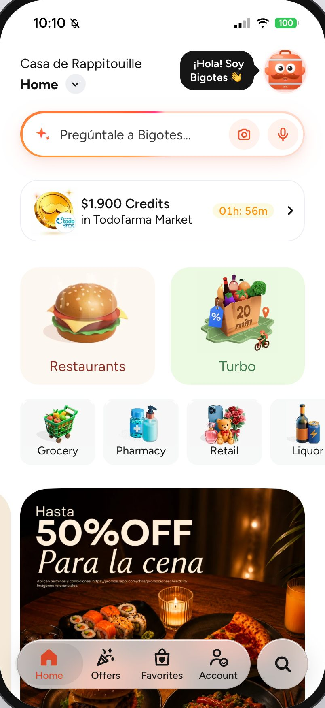
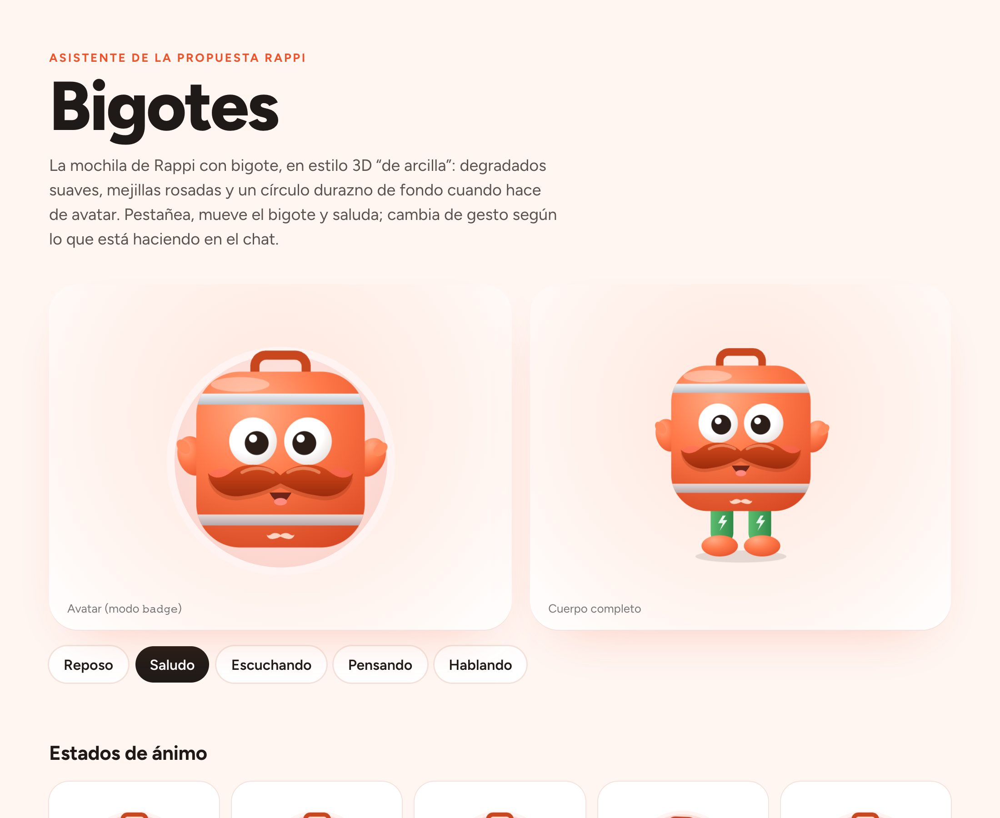
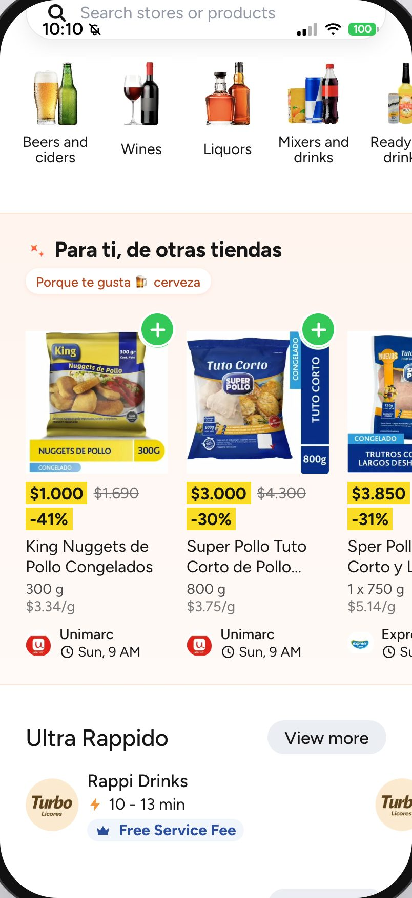
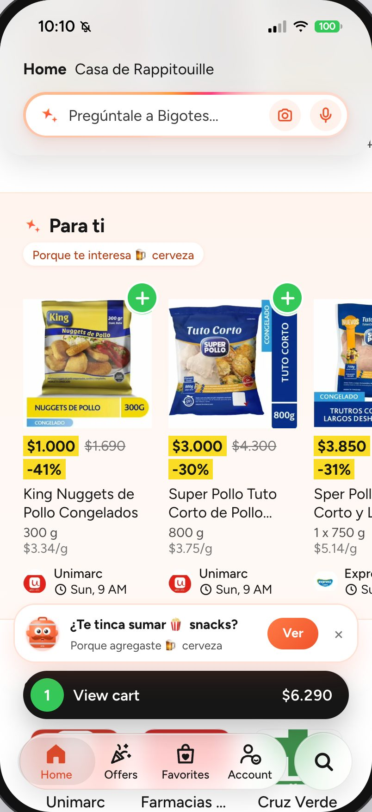
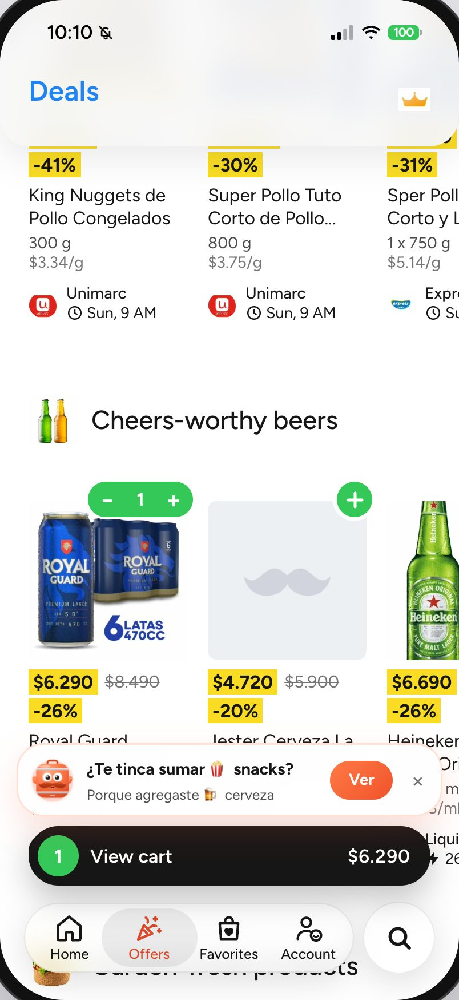

# Prototipo de la app

Maqueta navegable de la app de Rappi Chile, hecha a partir de capturas y videos del iPhone, para **mostrar la propuesta del proyecto**. Desde fuera, lo que un usuario hace en un vertical no parece influir en lo que se le recomienda en los demás. Aquí el asistente **Bigotes** aprende de lo que haces y recomienda **entre verticales** (cerveza → snacks, pizza → postre, pañales → farmacia).

> Imágenes, logos y marcas pertenecen a Rappi y a sus dueños; se usan solo como maqueta de demostración. Proyecto independiente, no afiliado ni respaldado por Rappi.

Hecho con Vite + React 19. Funciona de dos maneras:

- **Sin backend (modo local):** todo corre en el navegador. Bigotes responde con reglas locales sobre los datos del prototipo y las imágenes que no cargan muestran un respaldo neutro.
- **Con la API de [`rappi-ia`](../rappi-ia/):** Bigotes busca en el catálogo real. Si la API no responde o tarda más de 8 s, contestan las reglas locales y la respuesta lo marca con «Respuesta local».


*Salvo que se indique lo contrario, las capturas de este README están tomadas en modo local (sin API) y sin los menús reales del scraper.*

## Cómo correrlo

Requiere Node 22.22+ o 24.15+ (ver `.nvmrc` en la raíz). Desde la raíz del repositorio:

```bash
cd prototipo-app
npm ci
npm run dev              # http://localhost:5174
npm run dev -- --host    # para abrirlo en el iPhone (misma red wifi o su hotspot)
```

En el iPhone, desde Safari: **Compartir → Agregar a pantalla de inicio**. Se abre a pantalla completa con el ícono de Bigotes y el gesto "volver" funciona.

### Con la API de `rappi-ia`

Si la API está corriendo (`cd rappi-ia && make serve`, puerto 8000; carga los modelos antes de aceptar peticiones, así que conviene abrir el prototipo después de «Application startup complete»), Bigotes deja de ser un conjunto de reglas:

- busca en el **catálogo real** con búsqueda híbrida por vertical, con precios vigentes;
- sugiere un complemento **de otra tienda** en un bloque aparte;
- arma la fila **"Para ti"** del inicio con lo que aprendió de ti (productos reales de otro vertical, con aviso +18 si corresponde);
- registra eventos seudónimos y pedidos (uno por vertical) para el [panel de negocio](../dashboard-empresa/).

La API también ofrece `/chat/voice` (Whisper) y `/chat/photo` (CLIP), pero el prototipo actual no los usa: la Propuesta es un buscador, sin micrófono ni cámara.


*Con la API de rappi-ia: cervezas del catálogo real bajo $3.000 y, en un bloque aparte, snacks de otra tienda.*

- **Dónde busca la API:** en el mismo host desde el que se abrió la página, puerto 8000; desde el iPhone no hace falta configurar nada. Para apuntar a otra API, crea `.env.local` con `VITE_API_URL=http://localhost:8001`.
- **Desde el iPhone:** arranca la API con `make serve-lan` (abre la API a la red; solo en una red de confianza). Sirve en la wifi de casa, con el hotspot del iPhone y con `http://nombre-del-mac.local:5174`. macOS pedirá permiso de red la primera vez.

### Comandos

| Comando | Para qué |
|---|---|
| `npm test` | Tests (Vitest): Bigotes, buscador, carrito, perfil, navegación, precios, seguimiento, pedidos, hoja de producto, cliente de la API, accesibilidad del buscador |
| `npm run lint` | ESLint (reglas de React Hooks) |
| `npm run format` | Formato con Prettier |
| `npm run build` | Build de producción en `dist/` |
| `npm run screenshots` | Regenera las capturas de este README en modo local (usa el Chrome instalado) |
| `./scripts/export-menus.sh` | Exporta los menús reales desde Postgres a `src/data/generated/menus.json` (fuera de git) |
| `./scripts/make-icons.sh` | Regenera los íconos de pantalla de inicio desde `scripts/icon.svg` |

Tests: 232 (Vitest, 09-10-2026). CI en GitHub Actions: lint, tests y build.

**Accesibilidad:** el buscador con Bigotes y las hojas inferiores se usan con teclado y VoiceOver (el foco entra al abrir, Escape cierra, Tab no se sale y el foco vuelve al cerrar), cada respuesta de Bigotes se anuncia completa al lector de pantalla y las áreas táctiles miden al menos 40 px.

## Modo demo: Rappi hoy, Propuesta y Bigotes vivo

El interruptor junto al teléfono (tecla **D**, o Account → Modo demo en el celular) cambia entre la app como es hoy, la propuesta y un tercer prototipo de prueba, **Bigotes vivo**.

| Rappi hoy | Propuesta |
|:---:|:---:|
|  |  |
| Buscador original | La misma barra abre el buscador con Bigotes |

**Bigotes vivo** no tiene chat: Bigotes de cuerpo entero vive en la Home (`src/screens/home/live/`). Al entrar dice qué notó («te encantan los chocolates») y sube ese bloque bajo el buscador con el resto oscurecido; al lado aparece una vertical donde nunca pediste. La Home suma un pasaporte de verticales, «¿Qué plan tienes hoy?» (un kit de varias verticales) y, al tocar a Bigotes, una vertical por probar. Bigotes saluda al llegar, salta, apunta y gira según lo que dice, y en espera mira alrededor, baila o se estira; sin nada que decir se asoma desde el borde y al hacer scroll se esconde, para no tapar la Home. En el celular, «Repetir escena de Bigotes» está en Account. «↺ Repetir escena», junto al interruptor, vuelve a empezar. Respeta «reducir movimiento» del sistema.

## Lo nuevo de la propuesta

### Bigotes, el buscador

En la Propuesta no hay chat escrito, voz ni foto: la barra de la Home («¿Qué se te antoja hoy?») abre el buscador con Bigotes, que reúne el buscador de siempre y lo que Bigotes sabe de ti:

- **Aprendiendo de ti:** arriba muestra lo que va aprendiendo («🍺 Cerveza · 🥃 Copete») y un botón **Olvidar** que lo borra, también en la API.
- **Toca y te armo algo:** botones con ideas («¿Qué almuerzo hoy?», «Arma un carrete», «Algo dulce») que cambian según lo aprendido. Al tocar uno, Bigotes responde con productos y tiendas; si abres una tienda desde ahí y vuelves, la búsqueda sigue donde estaba.
- **El campo de búsqueda** encuentra tiendas y productos; debajo siguen «Recent searches» y «Popular stores», como en la app.
- **Descubre con Bigotes:** las verticales que todavía no exploraste («Exploraste 3 de 9»), cada una con una entrada para probarla.


*Buscador con Bigotes tras tocar «Arma un carrete» (modo local).*

La captura `docs/screenshots/21-voz.jpg` es de una versión anterior del prototipo (voz), que ya no existe.

Diseño y animaciones del personaje: [`design/bigotes.html`](design/bigotes.html) (descargar y abrir en el navegador).



*Ficha del personaje: diseño y animaciones.*

### Recomendaciones entre verticales

Capturas en modo local: las reglas locales usan los productos del prototipo. Con la API, las mismas filas se llenan con productos reales de otro vertical.

| En cada vertical | En la Home | Al agregar al carrito |
|:---:|:---:|:---:|
|  |  |  |
| "Para ti, de otras tiendas": en Liquor recomienda carnes y snacks del súper, con la razón visible. | "Para ti" parte de tu interés principal. | "¿Te tinca sumar 🍿 snacks?": uno por tema por sesión. |

### Compra completa

| Checkout | Seguimiento | Entregado |
|:---:|:---:|:---:|
|  |  |  |
| Delivery o retiro, propina y desglose (envío gratis con Pro). El medio de pago es un texto de ejemplo. | Simulado: los pasos avanzan solos y Bigotes recorre la ruta en el mapa. | Calificación y la siguiente sugerencia cruzada. |

También:

- **Hoja de producto:** al tocar un producto se abre una hoja con la cantidad, notas para la tienda y el total, y desde ahí se puede ir a la tienda.
- **Mis pedidos** (en Account): cada pedido hecho en el prototipo abre su seguimiento, en curso o entregado; el carro, los favoritos, la dirección y Loyalty se guardan en el navegador y sobreviven a una recarga.
- **Turbo** con productos y categorías (Frescos, Despensa, Picoteo) que se agregan al carro, además de las pestañas Favorites, Offers y Categories.
- **Menús reales** de los restaurantes descargados por el scraper, en la sección "Cerca de ti" de Restaurants, con pestañas por sección. Son opcionales: se exportan con `./scripts/export-menus.sh` y no van en git ni en las capturas.
- **Loyalty**, con un programa de fidelización vinculable.
- **Si algo falla:** una pantalla con error muestra «Algo salió mal» y «Volver al inicio» sin cerrar la app, y una imagen que no carga muestra un respaldo neutro.


*Loyalty con un programa vinculado (modo local).*

## Pantallas replicadas de Rappi

Calcadas de las capturas del iPhone, en modo "Rappi hoy" (sin agregados de la propuesta).

| Restaurants | Turbo | Deals | Favorites |
|:---:|:---:|:---:|:---:|
|  |  |  |  |

| Account | Grocery | Liquor | RappiTravel |
|:---:|:---:|:---:|:---:|
|  |  |  |  |

Además: Pharmacy, Retail, Express, Pet, Chocolates, Loyalty, buscador, página de tienda y carrito.

## Qué es real y qué es simulado

- **Real:** las pantallas (recortes de las capturas), los precios y productos que se ven en ellas, los menús del scraper (si se exportan), el carrito, los pedidos y el historial del navegador.
  - **Con la API** también son reales: la búsqueda y los productos y precios que muestra Bigotes.
- **Simulado:** el pago y el seguimiento.
  - **Sin la API** también son simuladas las respuestas de Bigotes (reglas sobre los datos del prototipo).
- **Privacidad:** el id de usuario es seudónimo (`proto-…`, guardado en este navegador). El carro, los favoritos, la dirección, Loyalty y los pedidos también se guardan solo en este navegador. "Olvidar" borra lo aprendido también en la API. En modo "Rappi hoy" no se aprende.
- **Supuestos:** textos cortados en el borde de las capturas, algunos ratings y tiempos de entrega; están marcados como "supuesto" en los archivos `data.js`.

## Estructura

```text
src/
├── api/            Cliente de la API de rappi-ia (chat, "Para ti", pedidos); si no responde, modo local
├── assistant/      Bigotes local: temas, respuestas y recomendaciones (lógica pura, con tests)
├── assets/         Recortes de las capturas
├── components/     Piezas compartidas; assistant/ tiene la mascota, la barra de la Home, el buscador con Bigotes y Descubre
├── data/           Catálogo y buscador; menús reales opcionales
├── hooks/          Navegación con historial, scroll
├── screens/        Una carpeta por pantalla (home, deals, vertical, checkout, tracking…)
├── state/          Carrito, perfil, pedidos, hoja de producto, modo demo, dirección… (varios persisten en localStorage)
└── styles/         Tokens de diseño y estilos globales
design/bigotes.html Ficha del personaje
docs/screenshots/   Capturas de este README
public/             Íconos y manifiesto para "Agregar a pantalla de inicio"
scripts/            Menús, íconos y capturas
```
