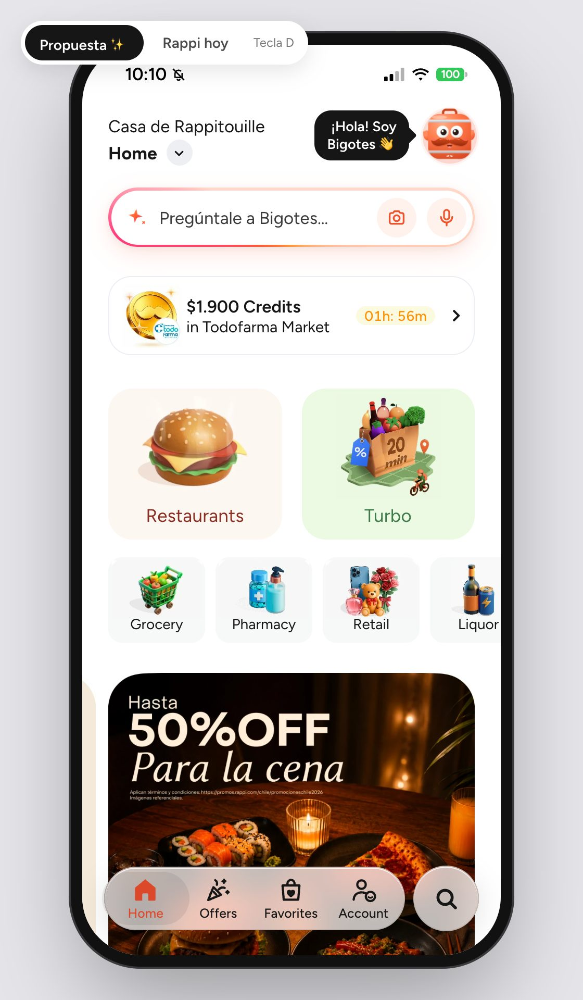
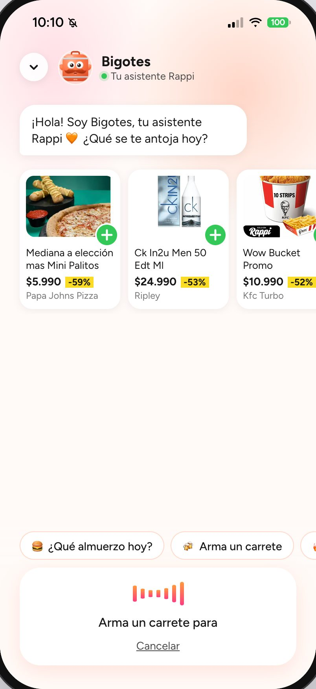

# Prototipo de la app Rappi

Réplica navegable de la app de Rappi Chile (hecha a partir de capturas y videos del iPhone) para **mostrar la propuesta del proyecto**: hoy el comportamiento de un usuario en un vertical no influye en los demás; aquí el asistente **Bigotes** aprende de lo que haces y recomienda **entre verticales** (cerveza → snacks, pizza → postre, pañales → farmacia).

Vite + React 19, sin backend: todo corre en el navegador con los datos de las capturas y, opcionalmente, los menús reales del scraper.



## Cómo correrlo

```bash
npm install
npm run dev              # http://localhost:5174
npm run dev -- --host    # para abrirlo en el iPhone (misma red WiFi)
```

En el iPhone, desde Safari: **Compartir → Agregar a pantalla de inicio**. Se abre a pantalla completa con el ícono de Bigotes y el gesto "volver" funciona.

| Comando | Para qué |
|---|---|
| `npm run test` | Tests (Vitest): Bigotes, buscador, carrito, perfil, navegación, precios, seguimiento |
| `npm run lint` | ESLint (reglas de hooks de React) |
| `npm run screenshots` | Regenera las capturas de este README (usa el Chrome instalado) |
| `./scripts/export-menus.sh` | Exporta los menús reales desde Postgres a `src/data/generated/menus.json` (fuera de git) |
| `./scripts/make-icons.sh` | Regenera los íconos de pantalla de inicio desde `scripts/icon.svg` |

## Modo demo: Rappi hoy vs. Propuesta

El interruptor junto al teléfono (tecla **D**, o Account → Modo demo en el celular) cambia entre la app como es hoy y la propuesta.

| Rappi hoy | Propuesta |
|:---:|:---:|
|  |  |
| Buscador original | Barra inteligente (chat, foto y voz) y Bigotes arriba a la derecha |

## Lo nuevo de la propuesta

### Bigotes, el asistente

| Chat | Voz |
|:---:|:---:|
|  |  |
| Responde con productos y tiendas reales del prototipo. Arriba muestra lo que va aprendiendo ("Aprendiendo de ti: 🍺 Cerveza · 🥃 Copete") y las sugerencias de abajo cambian según eso. | Onda animada mientras escucha (la voz está simulada: por `http://` el iPhone bloquea el micrófono). La foto sí se puede tomar o elegir de verdad (cámara o galería) y aparece en el chat, pero hoy no sale del teléfono ni se analiza: la respuesta es simulada a partir de tus intereses. |

Diseño y animaciones del personaje: [`design/bigotes.html`](design/bigotes.html) (se abre con doble clic).


### Recomendaciones entre verticales

| En cada vertical | En la Home | Al agregar al carrito |
|:---:|:---:|:---:|
|  |  |  |
| "Para ti, de otras tiendas": en Liquor recomienda carnes y snacks del súper, con la razón visible. | "Para ti" parte de tu interés principal. | "¿Te tinca sumar 🍿 snacks?" — uno por tema por sesión. |

### Compra completa

| Checkout | Seguimiento | Entregado |
|:---:|:---:|:---:|
|  |  |  |
| Delivery o retiro, propina y desglose (envío gratis con Pro). El medio de pago es un texto de ejemplo. | Los pasos avanzan solos y Bigotes recorre la ruta en el mapa. | Calificación y la siguiente sugerencia cruzada. |

También: **menús reales** de los restaurantes ya descargados por el scraper (8 al 27-09-2026) (sección "Cerca de ti" en Restaurants, con pestañas por sección) y **Loyalty** con programa vinculable.


## Pantallas replicadas de Rappi

Calcadas de las capturas del iPhone (en modo "Rappi hoy", sin agregados de la propuesta).

| Restaurants | Turbo | Deals | Favorites |
|:---:|:---:|:---:|:---:|
|  |  |  |  |

| Account | Grocery | Liquor | RappiTravel |
|:---:|:---:|:---:|:---:|
|  |  |  |  |

Además: Pharmacy, Retail, Express, Pet, Chocolates, Loyalty, buscador, página de tienda y carrito.

## Qué es real y qué es simulado

- **Real**: las pantallas (recortes de las capturas), los precios y productos que se ven en ellas, los menús del scraper, el carrito, el historial del navegador.
- **Simulado**: las respuestas de Bigotes (reglas sobre los datos del prototipo, sin IA), la voz, el reconocimiento de foto, el pago y el seguimiento.
- **Supuestos**: textos cortados en el borde de las capturas, algunos ratings y tiempos de entrega; están marcados como "supuesto" en los archivos `data.js`.
- Las capturas de este README se toman **sin los menús reales** (son datos scrapeados y no se suben al repo).

## Estructura

```text
src/
├── assistant/      Bigotes: temas, respuestas y recomendaciones (lógica pura, con tests)
├── components/     Piezas compartidas; assistant/ tiene la mascota, la barra inteligente y el chat
├── data/           Catálogo y buscador; menús reales opcionales
├── hooks/          Navegación con historial, scroll
├── screens/        Una carpeta por pantalla (home, deals, vertical, checkout, tracking…)
└── state/          Carrito, perfil, pedidos, modo demo, dirección…
design/bigotes.html Ficha del personaje
docs/screenshots/   Capturas de este README
scripts/            Menús, íconos y capturas
```
