# Prototipo de la app

Maqueta navegable de la app de Rappi Chile, hecha a partir de capturas y videos del iPhone, para **mostrar la propuesta del proyecto**. Desde fuera, lo que un usuario hace en un vertical no parece influir en lo que se le recomienda en los demás. Aquí el asistente **Mochi** aprende de lo que haces y recomienda **entre verticales** (cerveza → snacks, pizza → postre, pañales → farmacia).

> Imágenes, logos y marcas pertenecen a Rappi y a sus dueños; se usan solo como maqueta de demostración. Proyecto independiente, no afiliado ni respaldado por Rappi.

Hecho con Vite + React 19. Funciona de dos maneras:

- **Sin backend (modo local):** todo corre en el navegador. Mochi responde con reglas locales sobre los datos del prototipo y las imágenes que no cargan muestran un respaldo neutro.
- **Con la API de [`rappi-ia`](../rappi-ia/):** Mochi busca en el catálogo real. Si la API no responde o tarda más de 8 s, contestan las reglas locales y la respuesta lo marca con «Respuesta local».


*Salvo que se indique lo contrario, las capturas de este README están tomadas en modo local (sin API) y sin los menús reales del scraper.*

## Cómo correrlo

Requiere Node 22.22+ o 24.15+ (ver `.nvmrc` en la raíz). Desde la raíz del repositorio:

```bash
cd prototipo-app
npm ci
npm run dev              # http://localhost:5174
npm run dev -- --host    # para abrirlo en el iPhone (misma red wifi o su hotspot)
```

En el iPhone, desde Safari: **Compartir → Agregar a pantalla de inicio**. Se abre a pantalla completa con el ícono de Mochi y el gesto "volver" funciona.

### Con la API de `rappi-ia`

Si la API está corriendo (`cd rappi-ia && make serve`, puerto 8000; carga los modelos antes de aceptar peticiones, así que conviene abrir el prototipo después de «Application startup complete»), Mochi deja de ser un conjunto de reglas:

- busca en el **catálogo real** con búsqueda híbrida por vertical, con precios vigentes;
- sugiere un complemento **de otra tienda** en un bloque aparte;
- arma la fila **"Para ti"** del inicio con lo que aprendió de ti (productos reales de otro vertical, con aviso +18 si corresponde);
- registra eventos seudónimos y pedidos (uno por vertical) en la API, para medir las sugerencias (mostradas, aceptadas y convertidas).

La API también ofrece `/chat/voice` (Whisper) y `/chat/photo` (CLIP), pero el prototipo actual no los usa: el prototipo final tiene un buscador, sin micrófono ni cámara.


*Con la API de rappi-ia: cervezas del catálogo real bajo $3.000 y, en un bloque aparte, snacks de otra tienda. Es una captura anterior: todavía con Bigotes y el chat escrito, que ya no existe.*

- **Dónde busca la API:** en el mismo host desde el que se abrió la página, puerto 8000; desde el iPhone no hace falta configurar nada. Para apuntar a otra API, crea `.env.local` con `VITE_API_URL=http://localhost:8001`.
- **Desde el iPhone:** arranca la API con `make serve-lan` (abre la API a la red; solo en una red de confianza). Sirve en la wifi de casa, con el hotspot del iPhone y con `http://nombre-del-mac.local:5174`. macOS pedirá permiso de red la primera vez.

### Comandos

| Comando | Para qué |
|---|---|
| `npm test` | Tests (Vitest): Mochi, buscador, carrito, perfil, navegación, precios, seguimiento, pedidos, hoja de producto, cliente de la API, accesibilidad del buscador |
| `npm run lint` | ESLint (reglas de React Hooks) |
| `npm run format` | Formato con Prettier |
| `npm run build` | Build de producción en `dist/` |
| `npm run screenshots` | Regenera las capturas de este README en modo local (usa el Chrome instalado) |
| `./scripts/export-menus.sh` | Exporta los menús reales desde Postgres a `src/data/generated/menus.json` (fuera de git) |
| `./scripts/make-icons.sh` | Regenera los íconos de pantalla de inicio desde `scripts/icon.svg` |

Tests: 232 (Vitest, 09-10-2026). CI en GitHub Actions: lint, tests y build.

**Accesibilidad:** el buscador con Mochi y las hojas inferiores se usan con teclado y VoiceOver (el foco entra al abrir, Escape cierra, Tab no se sale y el foco vuelve al cerrar), cada respuesta de Mochi se anuncia completa al lector de pantalla y las áreas táctiles miden al menos 40 px.

## Modo demo: Rappi hoy y Prototipo final

El interruptor junto al teléfono (tecla **D**, o Account → Modo demo en el celular) cambia entre la app como es hoy (**Rappi hoy**, «para hoy») y el **Prototipo final**, que arranca por defecto. Antes eran tres modos («Propuesta», «Rappi hoy» y «Bigotes vivo»); los dos con el asistente se juntaron en uno. Quien tenía guardado un modo viejo entra al prototipo final.

| Rappi hoy | Prototipo final |
|:---:|:---:|
| 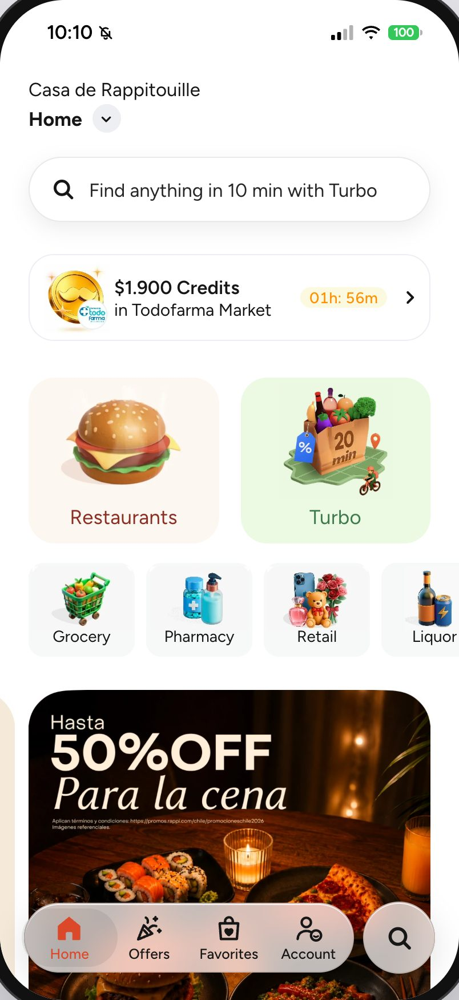 | 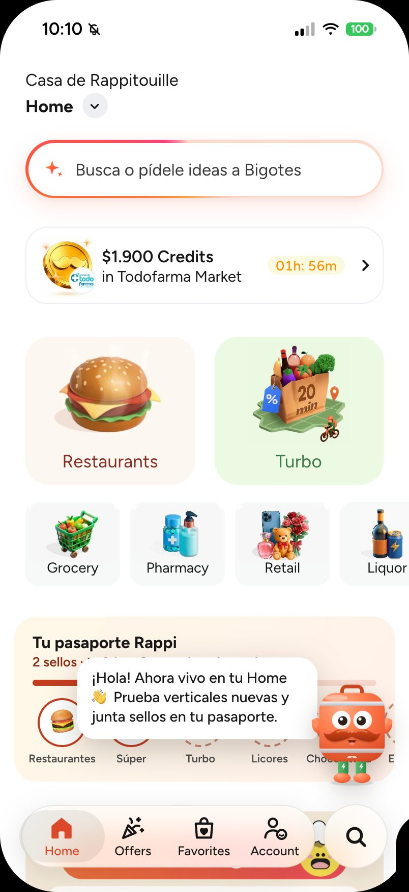 |
| Buscador original | Mochi vive en la Home y la misma barra abre su buscador |

En el **prototipo final** Mochi de cuerpo entero vive en la Home (`src/screens/home/live/`), sin ícono de chat. Al entrar saluda y, la primera vez, hace una guía de 3 pasos (el buscador, el pasaporte y «Jugar», con «Siguiente» y «Saltar»; no vuelve a aparecer, salvo con «Repetir escena»); no sugiere productos ni reordena la Home. La Home suma el pasaporte del juego de verticales (bajo los accesos de siempre; ver «Juego de verticales»), «¿Qué plan tienes hoy?» (un kit de varias verticales) y, al tocar a Mochi, una vertical por probar. Mochi saluda al llegar, salta, apunta y gira según lo que dice, y en espera mira alrededor, baila o se estira; sin nada que decir se asoma desde el borde y al hacer scroll se esconde, para no tapar la Home. Lo que se agrega al carro fuera de la Home lo comenta al volver, si combina con algo de otra vertical. La barra de la Home y la lupa de abajo abren el buscador con Mochi (ver más abajo), y al entregar un pedido ofrece armar el próximo. En el celular, «Repetir escena de Mochi» está en Account. «↺ Repetir escena», junto al interruptor, vuelve a empezar. Respeta «reducir movimiento» del sistema.

## Juego de verticales

En el prototipo final, el **pasaporte Rappi** de la Home es el del juego de verticales (traído de `rappi-juego-verticales`, que queda como histórico): 9 sellos (Súper, Express, Turbo, Licores, Chocolatería, Restaurantes, Farmacia, Rappi Mall y Viajes), uno por vertical en nivel Explorador o más. Un sello se gana jugando (descubrir un dato) o abriendo la vertical en la app (Viajes: RappiTravel); Conocedor y Experto, solo jugando, y se ven en el borde del sello. Con 4 sellos, envío gratis en la demo.

- **Desde la Home:** el título del pasaporte abre el pasaporte del juego; «Jugar», su camino de verticales; cada sello, su hoja con «Jugar» y «Abrir {vertical}». Mochi, al tocarlo, propone jugar la primera vertical sin sello.
- **Mientras llega el pedido:** el seguimiento ofrece «Juega mientras llega tu pedido», una ronda de 5 pasos en una vertical sin sello. Arriba, una franja con el tiempo que falta; si el pedido llega a mitad de ronda, avisa con «Ver pedido».
- **El juego:** cada vertical enseña su mundo (el cacao en Chocolatería, el vino y el pisco en Licores, aviones y destinos en Viajes; Súper, Express y Turbo traen temas variados). Una ronda tiene 5 pasos: 2 datos «¿Sabías que…?» que se dan vuelta, 2 preguntas curiosas y 1 desafío del catálogo (Viajes, sin catálogo: 3 preguntas). Los datos van al álbum con su fuente, que se abre en otra pestaña. Además, XP y nivel (Conocedor: 6 de las 12 tarjetas y 3 aciertos; Experto: las 12 y 8), misión del día y racha.
- **Contenido:** 108 tarjetas (6 datos y 6 preguntas por vertical) en `src/game/knowledge.json`, escritas con palabras propias y verificadas una por una contra su fuente ([informe](../docs/resultados/juego-verificacion-2026-10-09.md)). Los desafíos del catálogo usan agregados del catálogo del 05-10-2026 (`src/data/verticales.json`, sin conceptos sensibles; `npm run datos -- "<04 Mapa multivertical.html>"` los regenera).
- **Farmacia** se puede jugar desde el pasaporte, pero ni Mochi ni el seguimiento la proponen (la salud no se empuja). Licores lleva la marca «+18».
- El progreso es de demo: se guarda solo en el navegador. «Repetir escena» lo deja como al empezar.

| El juego | Mientras llega el pedido |
|:---:|:---:|
| 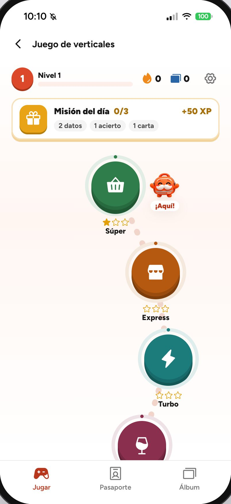 | 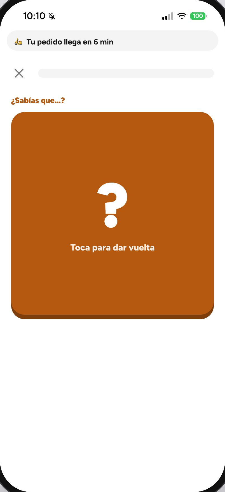 |
| Camino de verticales, misión del día y nivel | La ronda muestra cuánto falta para el pedido |

## Lo nuevo de la propuesta

### Mochi, el buscador

En el prototipo final no hay chat escrito, voz ni foto: la barra de la Home («¿Qué se te antoja hoy?») abre el buscador con Mochi, que reúne el buscador de siempre y lo que Mochi sabe de ti:

- **Aprendiendo de ti:** arriba muestra lo que va aprendiendo («🍺 Cerveza · 🥃 Copete») y un botón **Olvidar** que lo borra, también en la API.
- **Toca y te armo algo:** botones con ideas («¿Qué almuerzo hoy?», «Arma un carrete», «Algo dulce») que cambian según lo aprendido. Al tocar uno, Mochi responde con productos y tiendas; si abres una tienda desde ahí y vuelves, la búsqueda sigue donde estaba.
- **El campo de búsqueda** encuentra tiendas y productos; debajo siguen «Recent searches» y «Popular stores», como en la app.
- **Descubre con Mochi:** las verticales que todavía no exploraste («Exploraste 3 de 9»), cada una con una entrada para probarla.

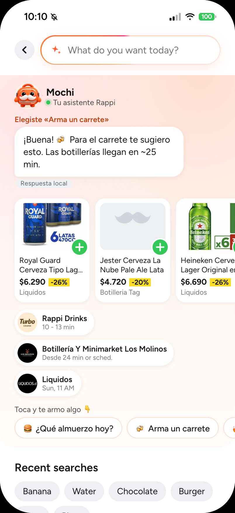

*Buscador con Mochi tras tocar «Arma un carrete» (modo local).*

La captura `docs/screenshots/21-voz.jpg` es de una versión anterior del prototipo (voz), que ya no existe.

Mochi es la mochila Rappi con bigote. En la app usa 4 poses de una sola imagen (`src/assets/mochi-poses.webp`): frontal (quieto), feliz (saluda o lo señalas con el mouse), tímido (piensa o escucha) y saltando (al tocarlo). Respira, se inclina hacia el mouse y, en la Home, salta, gira y baila según lo que dice.

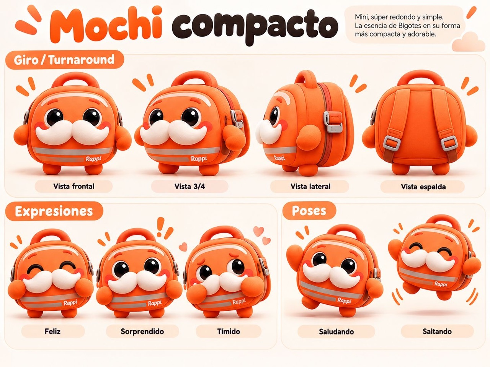

*Ficha del personaje: giro, expresiones y poses.*

### Recomendaciones entre verticales

En el prototipo final no hay filas de sugerencias al entrar a una vertical ni en la Home: Mochi recomienda entre verticales cuando se le pide (el buscador con Mochi, «Preguntarle a Mochi» en un producto, «¿Me falta algo?» en el checkout) y, en la Home, comenta lo agregado si combina con algo de otra vertical.

### Mochi en los momentos clave

- **Sin resultados:** si el buscador con Mochi no encuentra nada pero la consulta es de un tema conocido («chela» → cerveza), Mochi dice «Aquí no hay «chela», pero en Licores sí» y lleva ahí. Si no reconoce el tema, invita a buscar con otras palabras. Nunca ofrece Farmacia ni cosas de bebé por su cuenta.
- **Pedido en camino:** en el mapa, Mochi está tímido mientras se prepara el pedido, de frente en camino y feliz con «¡Ya casi!» en el tramo final; al llegar, salta en el aviso del juego.
- **¿Me falta algo?:** en el checkout, un botón «¿Me falta algo? Pregúntale a Mochi». Solo al tocarlo, Mochi sugiere UNA cosa de otra vertical con su razón («Llevas 🍺 Cerveza → 🥩 Carnes»), «Agregar» y «Deshacer». Nada aparece por su cuenta.

### Mochi fuera de la Home

En el prototipo final, Mochi flota a un costado en las demás pantallas (no en la Home, el buscador con Mochi, el juego, el checkout ni el seguimiento), sobre la barra inferior o la del carrito, y se achica al hacer scroll:

- **Tocarlo:** salta y abre un menú: «Buscar con Mochi», «Revisar mi carrito · $total» (o «¿Qué puedo probar?» con el carro vacío), «Mover al otro lado» y «Silenciar por hoy». Escape o tocar fuera lo cierran.
- **Moverlo:** arrastrarlo lo deja en el lado más cercano; el lado se recuerda en el navegador.
- **Al agregar al carro:** «¡Listo! … está en tu carrito» con «Deshacer», 4 s. No sugiere nada: eso queda para la Home al volver.
- **Preguntarle por un producto:** mantener presionada una tarjeta muestra «Preguntarle a Mochi» (abre el buscador con «¿Con qué acompaño …?»). En escritorio también se puede arrastrar la tarjeta hasta Mochi.
- **Silencio:** «Silenciar por hoy» lo deja como una pestañita en el borde hasta mañana (tocarla lo despierta). Si se cierran dos globos seguidos, no habla por su cuenta el resto de la sesión. «Repetir escena» lo despierta.

### Compra completa

| Checkout | Seguimiento | Entregado |
|:---:|:---:|:---:|
| 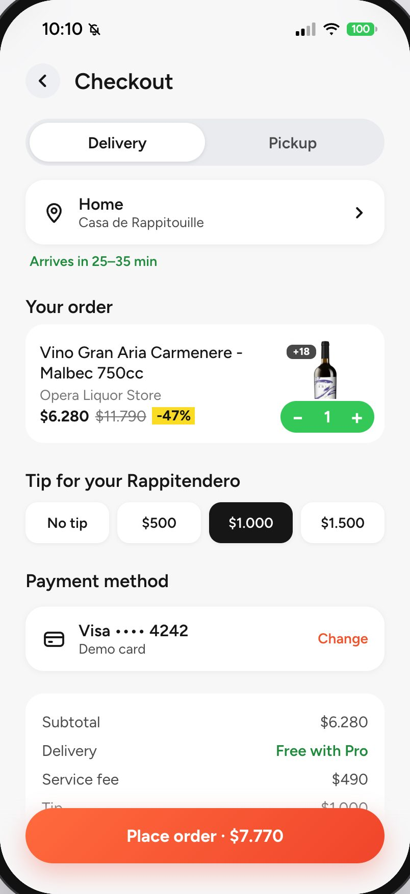 | 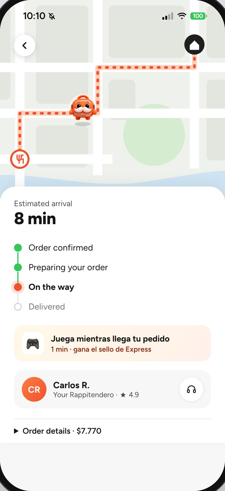 | 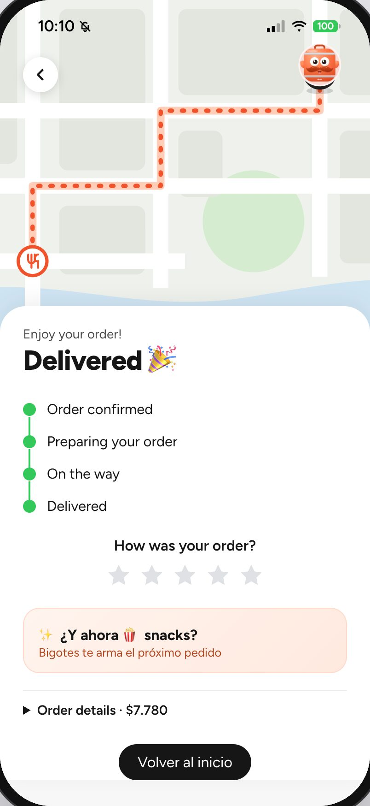 |
| Delivery o retiro, propina y desglose (envío gratis con Pro). El medio de pago es un texto de ejemplo. | Simulado: los pasos avanzan solos y Mochi recorre la ruta en el mapa; se puede jugar mientras llega. | Calificación y la siguiente sugerencia cruzada. |

También:

- **Hoja de producto:** al tocar un producto se abre una hoja con la cantidad, notas para la tienda y el total, y desde ahí se puede ir a la tienda.
- **Mis pedidos** (en Account): cada pedido hecho en el prototipo abre su seguimiento, en curso o entregado; el carro, los favoritos, la dirección y Loyalty se guardan en el navegador y sobreviven a una recarga.
- **Turbo** con productos y categorías (Frescos, Despensa, Picoteo) que se agregan al carro, además de las pestañas Favorites, Offers y Categories.
- **Menús reales** de los restaurantes descargados por el scraper, en la sección "Cerca de ti" de Restaurants, con pestañas por sección. Son opcionales: se exportan con `./scripts/export-menus.sh` y no van en git ni en las capturas.
- **Loyalty**, con un programa de fidelización vinculable.
- **Si algo falla:** una pantalla con error muestra «Algo salió mal» y «Volver al inicio» sin cerrar la app, y una imagen que no carga muestra un respaldo neutro.

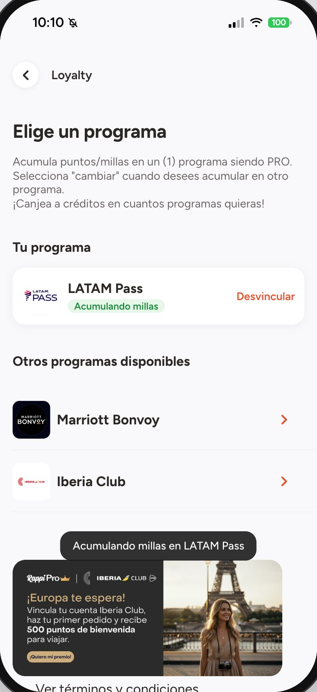

*Loyalty con un programa vinculado (modo local).*

## Pantallas replicadas de Rappi

Calcadas de las capturas del iPhone, en modo "Rappi hoy" (sin agregados de la propuesta).

| Restaurants | Turbo | Deals | Favorites |
|:---:|:---:|:---:|:---:|
| 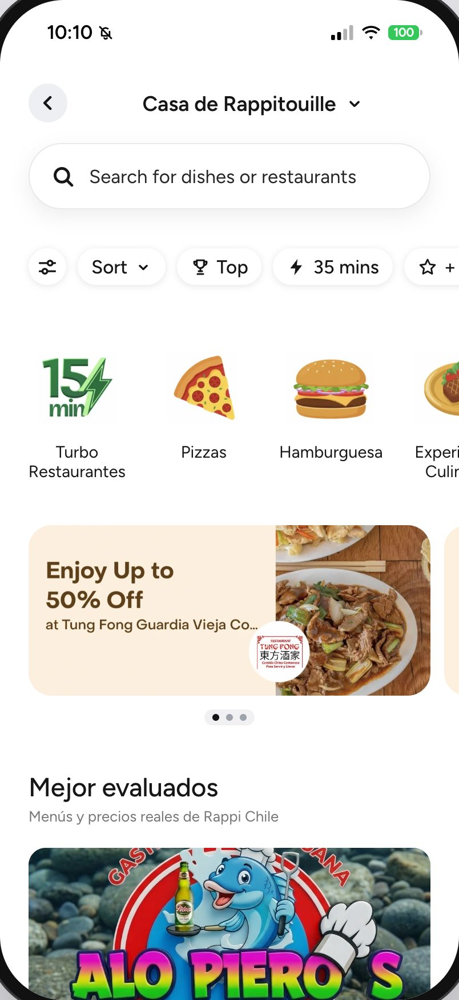 | 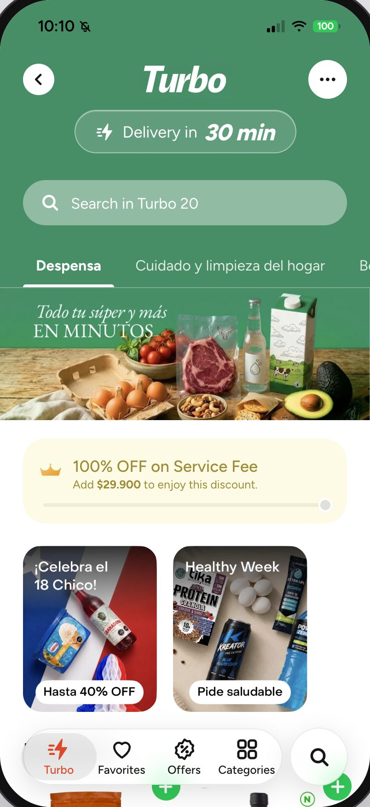 | 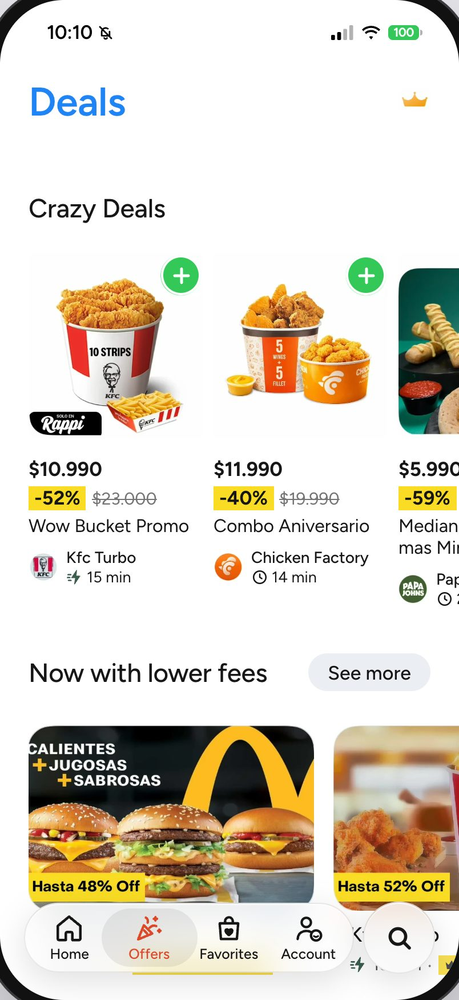 | 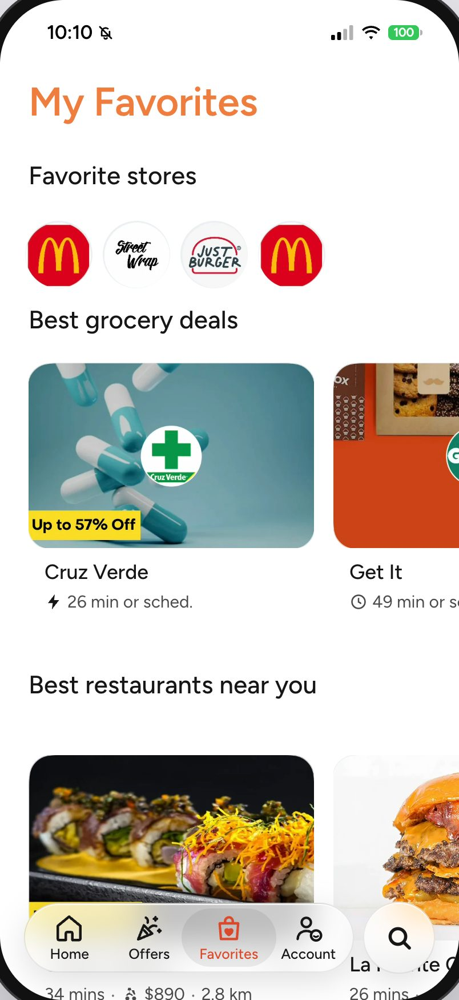 |

| Account | Grocery | Liquor | RappiTravel |
|:---:|:---:|:---:|:---:|
| 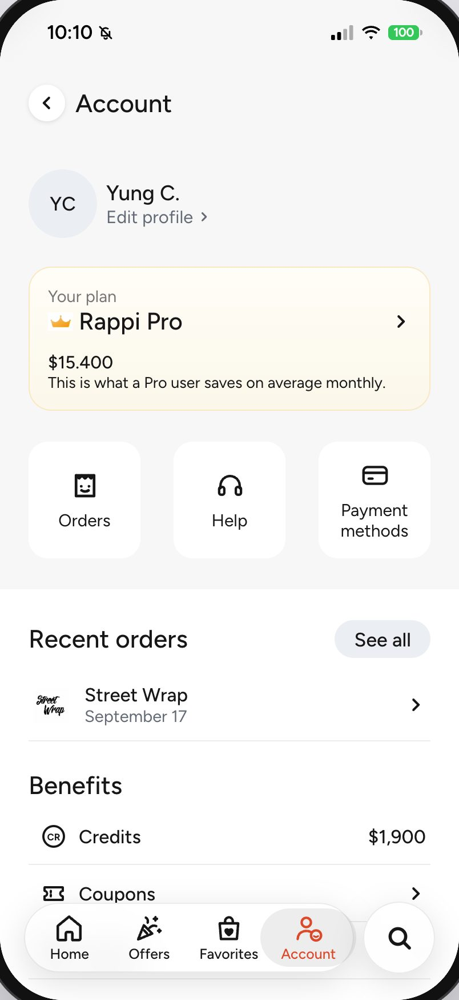 | 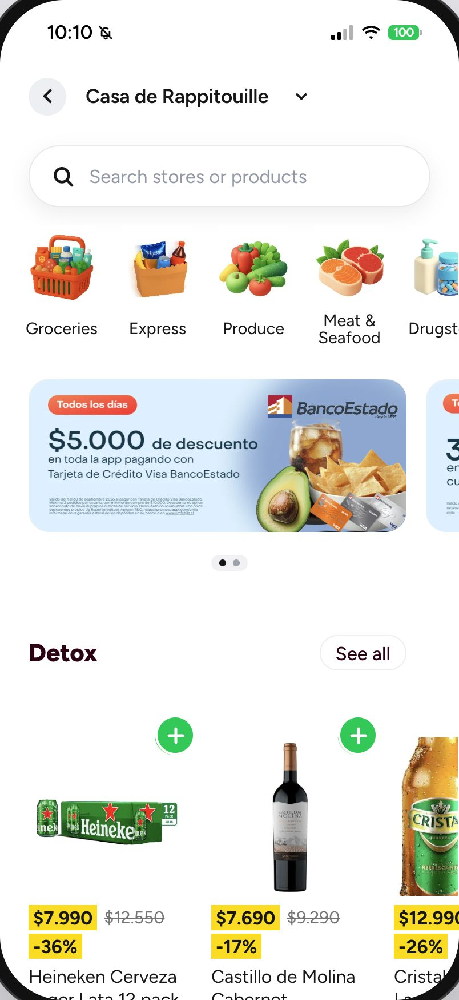 | 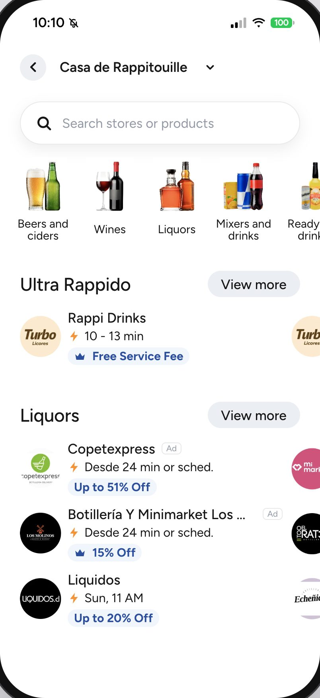 |  |

Además: Pharmacy, Retail, Express, Pet, Chocolates, Loyalty, buscador, página de tienda y carrito.

## Qué es real y qué es simulado

- **Real:** las pantallas (recortes de las capturas), los precios y productos que se ven en ellas, los menús del scraper (si se exportan), el carrito, los pedidos y el historial del navegador.
  - **Con la API** también son reales: la búsqueda y los productos y precios que muestra Mochi.
- **Simulado:** el pago y el seguimiento (el pedido «llega» a los 20 s), y el progreso del juego (solo en el navegador).
  - **Sin la API** también son simuladas las respuestas de Mochi (reglas sobre los datos del prototipo).
- **Privacidad:** el id de usuario es seudónimo (`proto-…`, guardado en este navegador). El carro, los favoritos, la dirección, Loyalty y los pedidos también se guardan solo en este navegador. "Olvidar" borra lo aprendido también en la API. En modo "Rappi hoy" no se aprende.
- **Supuestos:** textos cortados en el borde de las capturas, algunos ratings y tiempos de entrega; están marcados como "supuesto" en los archivos `data.js`.

## Estructura

```text
src/
├── api/            Cliente de la API de rappi-ia (chat, "Para ti", pedidos); si no responde, modo local
├── assistant/      Mochi local: temas, respuestas y recomendaciones (lógica pura, con tests)
├── assets/         Recortes de las capturas
├── game/           Lógica del juego de verticales: tarjetas de conocimiento, desafíos, XP, niveles, pasaporte (lógica pura, con tests)
├── components/     Piezas compartidas; assistant/ tiene la mascota, la barra de la Home, el buscador con Mochi y Descubre
├── data/           Catálogo y buscador; menús reales opcionales; verticales.json del juego
├── hooks/          Navegación con historial, scroll
├── screens/        Una carpeta por pantalla (home, deals, vertical, checkout, tracking, game…)
├── state/          Carrito, perfil, pedidos, hoja de producto, modo demo, dirección… (varios persisten en localStorage)
└── styles/         Tokens de diseño y estilos globales
docs/screenshots/   Capturas de este README
public/             Íconos y manifiesto para "Agregar a pantalla de inicio"
scripts/            Menús, íconos y capturas
```
