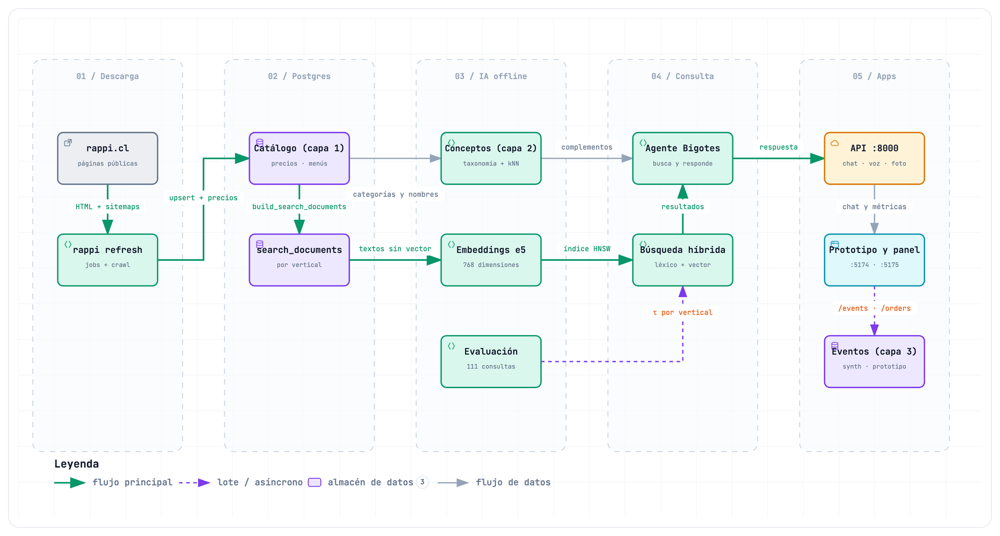

# rappi-ia

Conecta el catálogo que descarga [`rappi-scraper`](../rappi-scraper/) con el asistente **Bigotes** del [prototipo](../prototipo-app/) y con el [panel de negocio](../dashboard-empresa/). Diseño completo en [docs/diseno-ia.md](../docs/diseno-ia.md).

**Regla:** *buscar dentro del vertical, entender al usuario a través de los verticales*. La búsqueda nunca mezcla verticales. El puente entre ellos son los **conceptos**: una taxonomía propia de 132 conceptos, con 101 complementos curados entre sí. Una recomendación cruzada va del concepto que le interesa al usuario a su complemento, y de ahí a una búsqueda en el otro vertical (p. ej., cerveza en licores → snacks salados de otra tienda).



Versión interactiva: [rag-datos.html](../docs/diagramas/rag-datos.html). Vista por carriles: [arquitectura-ia.png](../docs/diagramas/arquitectura-ia.png) ([interactiva](../docs/diagramas/arquitectura-ia.html)). Los HTML se descargan y se abren en el navegador.

| Pieza | Qué hace | Dónde |
|---|---|---|
| Conceptos (capa 2) | Cada producto y plato → un concepto, con procedencia: categoría (mapa de 824 categorías generado con LLM: dos etiquetadores trabajan por separado y un juez decide cuando no coinciden; 12 ajustes a mano; versionado en `category_map.csv`), reglas por palabra o vecinos cercanos (kNN) | `concepts/` |
| Embeddings | Texto con `intfloat/multilingual-e5-base` (768 dim, caché por contenido, índice HNSW por vertical); imágenes con CLIP; voz con Whisper → texto | `embeddings/`, `agent/audio.py` |
| Búsqueda híbrida | Léxico (sin tildes ni ñ, IDF) + vectorial → RRF → refuerzo por concepto, con filtros dentro de cada lista y regla de "sin resultado" | `retrieval/hybrid.py` |
| Bigotes | Entender → buscar → sugerir un complemento de otro vertical → redactar (plantillas o Claude) → verificar | `agent/` |
| Eventos y analítica | Usuarios y eventos (hoy **simulados**), métricas de frecuencia, abandono, oportunidades y afinidad | `events/`, `analytics/` |

## Instalar

Desde la raíz del repositorio (requiere la base de [`rappi-scraper`](../rappi-scraper/)):

```bash
cd rappi-ia
make install      # .venv + rappi-scraper (esquema) + API + tests
make install-ml   # modelos locales: e5, CLIP, Whisper (y Claude opcional)
make db-test      # base rappi_ia_test (los tests no tocan rappi ni rappi_test)
make migrate
```

Los modelos (~2 GB) se descargan de Hugging Face la primera vez que se usan. Para que Claude redacte las respuestas, agrega `ANTHROPIC_API_KEY` en `.env`; sin clave, Bigotes responde con plantillas y las mismas reglas. Otras variables en `.env.example`.

## Correr

Después de cada `rappi refresh` del scraper:

```bash
make post-refresh                 # migrate + purge + concepts + embed + eval + synth + purge
./scripts/despues-del-refresh.sh  # lo mismo, pero espera a que termine un `rappi refresh` lanzado a mano
```

La tarea semanal del scraper (`make schedule` en `rappi-scraper/`) ya lo hace sola, con una diferencia: evalúa sin guardar τ.

| Objetivo | Qué hace |
|---|---|
| `make concepts` | Capa 2: conceptos por producto y plato (con kNN si está el extra `ml`) |
| `make embed` | Embeddings de texto (incrementales) + índices HNSW por vertical. No corre si hay una descarga del scraper en curso |
| `make eval` | Evalúa la búsqueda (léxico vs vectorial vs híbrido), recalibra τ (`src/rappi_ia/eval/thresholds.json`) y deja el reporte en `data/eval/busqueda.md` |
| `make synth` | Usuarios y eventos **simulados** para el panel (1.500 usuarios × 20 semanas, semilla 7; reemplaza los anteriores) |
| `make purge` | Borra el texto de las consultas con más de 90 días |
| `make analytics` | Resumen de métricas del panel en la terminal |
| `make images` | Fotos del catálogo con CLIP (miles de descargas: correr con el scraper detenido) |
| `make serve` / `make serve-lan` | API local / abierta a la red local (ver Seguridad) |
| `make test`, `make lint`, `make format` | Tests, revisión de estilo y formato |

`make help` lista todos los objetivos. Otros comandos:

- `rappi-ia search "algo para el carrete" --vertical licores`
- `rappi-ia concepts --solo-reporte`: cobertura sin recalcular.
- `rappi-ia embed-images --limit 50 --forzar`: una tanda chica de imágenes. **No** correrlo en masa mientras el scraper descarga.

## API (`make serve` → http://localhost:8000/docs)

| Endpoint | Para qué |
|---|---|
| `POST /chat` | Bigotes: `{message, vertical?, user_id?, session_id?, mode}`. Acepta los ids de vertical del prototipo (`liquor`, `grocery`…) |
| `POST /chat/voice`, `POST /chat/photo` | Voz (Whisper, audio ≤ 20 s) y foto (JPEG/PNG/WebP). No se guardan |
| `GET /search` | Búsqueda híbrida en un vertical, con precios vigentes |
| `GET /recommendations` | "Para ti, de otras tiendas": intereses → complementos → otro vertical |
| `GET /profile/{id}` · `DELETE /profile/{id}` | Lo aprendido (sin sensibles) · "Olvidar" (todo o un concepto) |
| `POST /events` · `POST /orders` | Eventos y pedidos del prototipo (`source = prototype`). Un pedido sin vertical del catálogo es un 400 |
| `POST /events/beacon` | Lo que queda en cola al cerrar la pestaña (`sendBeacon`, text/plain: sin preflight de CORS) |
| `GET /analytics/{kpis, weekly, opportunities, trends, funnel, cohorts, rhythm, at-risk, suggestions, multi-vertical, affinity, assortment, catalog}` | Métricas del panel |

**Seguridad.** Es una demo local y **no tiene autenticación**:
- **Por defecto:** `make serve` escucha solo en el equipo local (`127.0.0.1`).
- **Para el iPhone:** `make serve-lan` abre la API a la red local. Solo en una red de confianza.

**Privacidad:**
- **Datos personales en consultas:** se redactan antes de guardarlas (RUT con dígito verificador, teléfonos, correos, direcciones y tarjetas) y el texto se borra a los 90 días (`make purge`).
- **"Olvidar":** borra eventos y pedidos.
- **Sensibles:** los conceptos sensibles no entran al perfil ni a las palancas del panel.
- **Claude:** si hay clave, recibe solo hechos estructurados, nunca la consulta del usuario.

## Resultados

Medidos el 28-09-2026 sobre el catálogo completo. Resumen del proyecto en [README.md#resultados](../README.md#resultados).

**Catálogo indexado.** 240.200 documentos de búsqueda (83.108 productos, 153.136 platos y 3.956 tiendas), 100% con embedding.

### Búsqueda

**Set:** 96 consultas positivas en 6 verticales (supermercado, conveniencia, Mall, licores, chocolatería y restaurantes) y 15 negativas, en [`src/rappi_ia/eval/queries.json`](src/rappi_ia/eval/queries.json). Farmacia y Turbo no están en el set. La relevancia se juzga automáticamente por concepto: un resultado es relevante si su concepto es uno de los esperados para la consulta. `make eval` regenera el reporte.

| Modo | P@10 | MRR | nDCG@10 |
|---|---|---|---|
| Léxico | 0,735 | 0,842 | 0,744 |
| Vectorial | 0,818 | 0,887 | 0,825 |
| **Híbrido** | **0,884** | **0,922** | **0,889** |

| Tipo de consulta | n | nDCG@10 híbrido |
|---|---|---|
| Exactas (marca o producto) | 57 | 0,968 |
| Sin tildes ni ñ | 12 | 0,993 |
| Necesidades en lenguaje natural ("algo para el carrete") | 27 | 0,674 (léxico: 0,532) |

| Vertical | n | nDCG@10 híbrido |
|---|---|---|
| Chocolatería | 7 | 0,959 |
| Restaurantes | 11 | 0,944 |
| Conveniencia | 12 | 0,897 |
| Mall | 18 | 0,884 |
| Supermercado | 30 | 0,883 |
| Licores | 18 | 0,835 |

**"Sin resultado"** (demanda no satisfecha), sobre las 15 consultas negativas: precisión 1,00 (0 falsas alarmas) y recall 0,33 (5 de 15).

- **Regla:** es un "sin resultado" cuando nada calza todas las palabras y, además, se cumple la condición que corresponda:
  - si la consulta nombra un concepto, ese concepto no tiene surtido real en el vertical;
  - si no nombra ninguno, el coseno queda bajo τ.
- **Por qué bajó el recall:** con el catálogo completo, varias consultas "negativas" ya tienen coincidencias con todas sus palabras.
  - Algunas son oferta real que no estaba en los datos parciales: "kebab mixto" (16 platos), "comida mexicana con tacos" (restaurantes mexicanos). El set de negativas quedó desactualizado.
  - Otras son coincidencias casuales: "pizza familiar" encuentra un horno para pizza en Mall y "neumáticos" un renovador de neumáticos en conveniencia. Es un límite real de la regla léxica estricta.
- **Límite conocido:** un iPhone en el súper no cuenta como "sin resultado", porque hay accesorios del mismo concepto (celulares).

**Salvedades:**

- **Ventaja del híbrido sobreestimada:** el híbrido recibe un refuerzo por concepto, y la relevancia se juzga con ese mismo concepto.
- **Juez automático:** la relevancia depende de la asignación de conceptos, cuya precisión es una estimación (ver abajo). No hay juicio humano.
- **Set chico:** 96 consultas positivas, con pocas por vertical (7 en chocolatería); farmacia y Turbo sin evaluar.
- **Antes (27-09, datos parciales):** híbrido nDCG@10 0,898; "sin resultado" con precisión 0,91 y recall 0,67.

### Conceptos (capa 2)

Corrida del 28-09-2026: 132 conceptos, 101 complementos curados y 824 categorías mapeadas.

| Vertical | Con concepto |
|---|---|
| Restaurantes | 97,9% |
| Mall | 97,7% |
| Supermercado | 99,1% |
| Conveniencia | 99,8% |
| Licores | 100% |
| Farmacia | 96,7% |
| Turbo | 100% |
| Chocolatería | 100% |

**Precisión de la asignación (estimación).** Se midió con jueces LLM sobre los datos parciales del 27-09; la muestra no está versionada, así que la cifra no se puede reproducir tal cual.

| Tipo de asignación | Precisión estimada |
|---|---|
| Por categoría | ≈ 88% |
| Platos | ≈ 81% |
| Reglas por nombre | 55%: la parte más débil |

- **kNN:** en esa medición corrigió ítems puntuales, pero no subió la precisión global.
- **Siguiente mejora:** etiquetar con un LLM los ítems de baja confianza, revisar a mano los de mayor tráfico y versionar la muestra.

### Calidad

- **Revisión:** 3 rondas de revisión adversarial automatizada (agentes de IA especializados en lógica, seguridad y privacidad, frontend, rendimiento y contratos entre piezas) el 27-09-2026: 66 hallazgos confirmados y corregidos, con tests de regresión. El 28-09 hubo otra revisión adversarial de los cambios del día.
- **Tests:** 137 (pytest), contra la base `rappi_ia_test`. CI en GitHub Actions (`.github/workflows/ci.yml`) con Postgres + pgvector.
- **Optimizaciones del 28-09-2026:** textos por embeber ordenados por largo, índices HNSW con `maintenance_work_mem` de 1 GB (`HNSW_MAINTENANCE_WORK_MEM`) y kNN de conceptos que lee los vectores del caché en binario y por bloques.

## Límites

- **Datos simulados:** usuarios, eventos y pedidos son **simulados** (`source = 'synthetic'`), con supuestos explícitos en `events/synth.py`. El panel muestra la mecánica, no evidencia.
- **Muestra pública:** el catálogo es la muestra pública (hasta 24 productos por sub-pasillo), así que "no está" no significa "Rappi no lo vende".
- **Contenido de terceros:** fotos, descripciones y marcas pertenecen a Rappi y a los comercios; se usan solo con fines de investigación y demostración. Ver [README.md#uso-responsable-de-los-datos](../README.md#uso-responsable-de-los-datos).

## Estructura

```text
rappi-ia/
├── Makefile, pyproject.toml, .env.example
├── scripts/despues-del-refresh.sh   espera a que termine una descarga y corre make post-refresh
├── src/rappi_ia/
│   ├── cli.py         comandos de `rappi-ia`
│   ├── config.py      modelos, rutas y parámetros (por entorno)
│   ├── db.py          conexión a Postgres y migraciones (las de rappi-scraper)
│   ├── text.py        normalización de texto (sin tildes ni ñ)
│   ├── concepts/      taxonomía (taxonomy.toml), complementos (complements.toml), mapa de categorías (category_map.csv), reglas, kNN
│   ├── embeddings/    e5 y CLIP, caché de texto, imágenes, índices HNSW
│   ├── retrieval/     búsqueda híbrida por vertical
│   ├── agent/         Bigotes: entender, herramientas, redactar, voz, foto
│   ├── events/        eventos, perfil con decaimiento, "olvidar", generador simulado
│   ├── analytics/     métricas del panel
│   ├── eval/          set de evaluación (queries.json) y calibración de τ (thresholds.json)
│   └── api/           FastAPI
├── tests/
│   ├── unit/          sin base de datos
│   └── integration/   contra rappi_ia_test
└── data/              fuera de git: reporte de evaluación, logs
```

**Migraciones.** Viven en [`rappi-scraper/src/rappi_scraper/storage/migrations/`](../rappi-scraper/src/rappi_scraper/storage/migrations/), para que haya un solo historial. Las de esta capa:

| Migración | Qué agrega |
|---|---|
| `009_concepts.sql` | Taxonomía de conceptos, mapeo de categorías, complementos y concepto por ítem (con método, confianza y versión) |
| `010_embeddings.sql` | Caché de embeddings de texto, embeddings de imágenes y búsqueda léxica sin tildes ni ñ |
| `011_app_events.sql` | Usuarios, eventos y pedidos de la app (`synthetic` o `prototype`, nunca mezclados), con ids seudónimos |
| `012_concept_assortment.sql` | Surtido materializado por concepto, índice de eventos por fuente y aristas aprendidas por fuente |
| `013_search_price.sql` | Precio de cada documento como columna indexada: el filtro de precio de la búsqueda vectorial revisa todos los documentos cuando el tope deja pocos |
